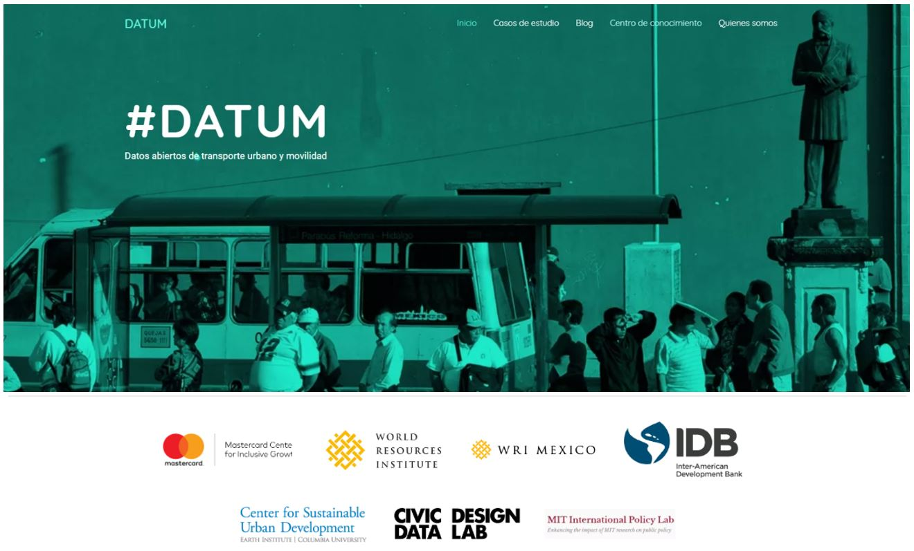
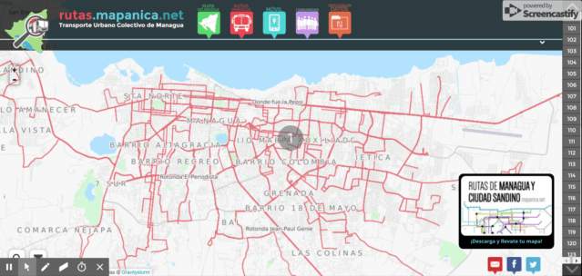
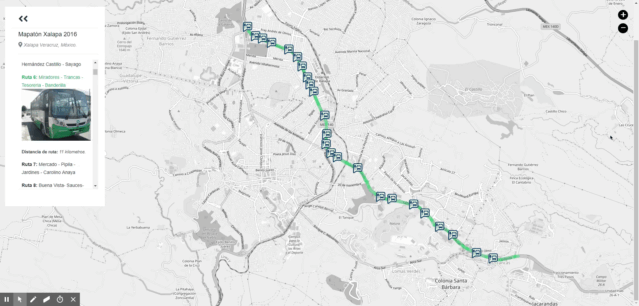
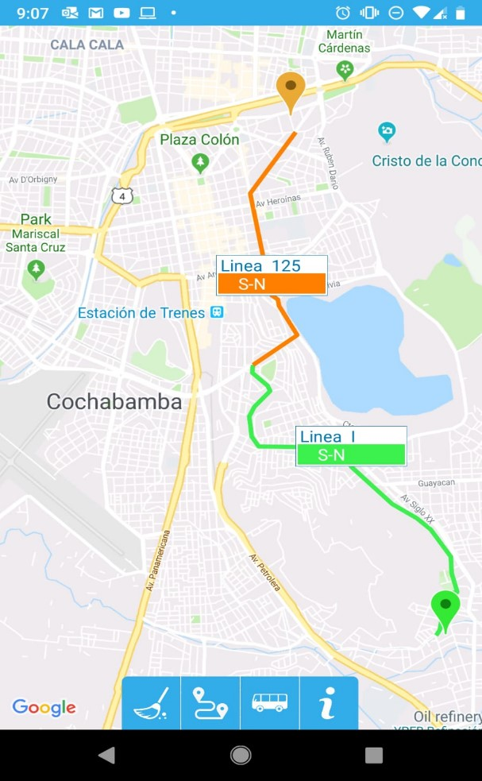
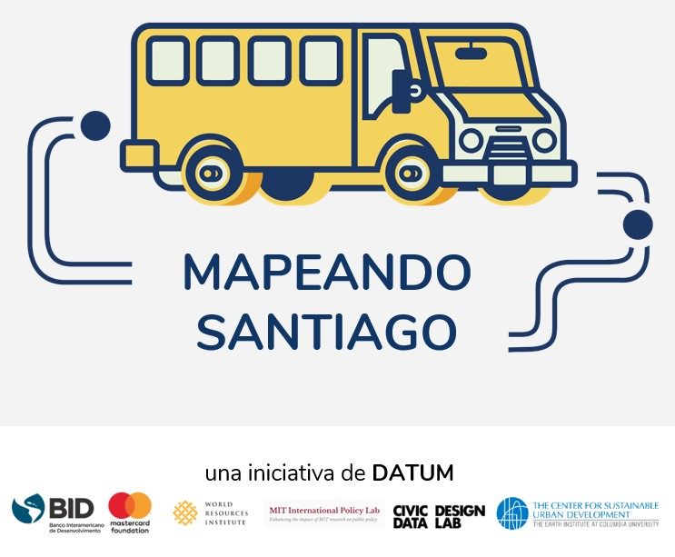

This article was originally posted on June 7, 2019 to the Inter-American Development Bank blog _Sustainable Cities_. It has since been [archived](https://web.archive.org/web/20251207224713/https://blogs.iadb.org/ciudades-sostenibles/en/opendata-urbantransport-mobility-latinamerica-caribbean/) on that blog and posted here.

## DATUM: facilitating community collection and public use of urban mobility data in the Americas

June 7, 2019 por Jordan Fischer - Edgar Lemus - Martin Quiroga - Patricio Zambrano Barragán Leave a Comment

Este artículo está también disponible en / This post is also available in: [Spanish](./2019-06-07-datum-esp.md)

In cities throughout Latin America and the Caribbean (LAC), public transport serves an essential role, connecting people with employment, commerce, leisure, and each other. However, public transport networks in LAC cities, both formal and informal, can lack detailed information about routes and schedules, leaving users to rely on word of mouth to know what routes can take them to their destination. Moreover, accurate and complete data is the basis for planning and decision-making processes when working towards the improvement of a city’s mobility system.

Enter community mapping, through which residents come together to gather detailed data on urban systems, ranging from informal settlements to mobility networks. Building on the growing relevance and importance of these crowdsourcing initiatives, the IDB’s Housing and Urban Development and Transport Divisions, together with partners WRI, Massachusetts Institute of Technology (MIT), Columbia University and MasterCard,are proud to launch DATUM, a regional platform that gathers past experiences, lessons learned, and open-source tools used, to serve as a central source of information on urban mobility mapping projects in LAC. Building on the initiatives already realized in the region, DATUM acts as a guide for collecting, processing, and publicizing urban mobility data. Those wishing to replicate a mapping project in their own city can visit datum.la to access a central cache of information on community mapping projects in the region. Some pioneering cities in LAC have already had great success mapping their urban mobility systems with crowdsourcing and community mapping techniques.

### MANAGUA, Nicaragua: MapaNica

MapaNica, the Nicaraguan chapter of OpenStreetMap was founded in 2012 and provides user-friendly open data on urban mobility routes – how to get around Managua using public transport, bicycle, or on foot. The open-source website, mapanica.net, provides detailed and interactive data and maintained by the diverse community that contributes to the project.

*Routes mapped on MapaNica’s interactive website.MapaNica.net, 2017 OpenStreetMap. 2012*

### XALAPA, Mexico: MapMap

Public transport was mapped using a data collection app called MapMap, in Veracruz’s capital in 2016 and 2017. The initiative was launched with a citizen mapathon coordinated by Codeando Xalapa and the city government of Xalapa with methodological support from the World Resource Institute (WRI) and OpenStreetMap. The 162 routes successfully mapped across the city are displayed on an [interactive website](https://mapaton.org/rutas/).

### COCHABAMBA, Bolivia: Cochala

Highly decentralized systems left much guesswork to riders in Cochabamba, until a coalition of academic, coding, community-based, and international partners came together to map transport routes in the city and launch the Guía Cochala in December 2017. This free app is a lightning-fast mapping tool that helps users find their way between any two points in the city using public transport. With almost 10 thousand downloads in the first 5 months after its launch, Guía Cochala promises to revolutionize the public transport experience in Cochabamba. The project’s success reached international heights when the program coordinators were contacted to incorporate the mobility data that they had collected into global databases like OpenStreetMap.

*The Guia Cochala app shows an optimized path between any two points selected by the user. Guía Cochala, 2018.*

### SANTIAGO DE LOS CABALLEROS, Dominican Republic: Mapeando Santiago

To mark the launch of DATUM, the IDB and its partners have started a community mapping pilot in Santiago de los Caballeros, Dominican Republic. Santiago does not currently have comprehensive, standardized information on transport routes open to the public. This affects residents’ ability to move around their city, limiting access to employment opportunities, especially among residents with fewer resources.

Mapeando Santiago, as the initiative is called, seeks to address this by mapping over 60 routes in the greater Santiago area, including intercity routes, using open data and open-source code. The pilot is being carried out in collaboration with the city’s Municipal authorities, CDES, and the Pontificia Universidad Católica Madre y Maestra (PUCMM), as well as with transport operators, users, and civil society stakeholders.

Between June 10th and June 28th, students from PUCMM will travel the city collecting standardized data using the same MapMap app used in Xalapa. Students will be assigned a route, travel along it using the MapMap app on their phones to record the movement in GTFS data, verify the route, and add it to the central dataset. Once the data quality is verified, routes will be additionally consulted with civil society to gather additional information such as safety and inclusion.

The results of Mapeando Santiago will be shared with city planners and transport authorities to improve services and related policies, shared with mapping service providers such as Google Maps and Moovit to incorporate into their datasets, and made available to the general public through the DATUM platform. The results of Mapeando Santiago will be presented in August 2019, and the data will be made available in the upcoming IDB-sponsored hackathon to be held in the Dominican Republic in the fall of 2019. This will reinforce local capacity with GTFS and geospatial analysis fostered during the initial project.

[image not available]

**Open data and open-source software** keep projects transparent and accountable to residents and improve access to the data. A [standardized GTFS format](https://en.wikipedia.org/wiki/GTFS#Structure) ensures that data will be compatible with apps and software used in the transit field. Open-source software has the added benefit of increasing the sustainability of a project, as an interruption in funding will not affect the use of the software.

Sustainability can also be promoted by the involvement of local groups. Already established local communities – such as OpenStreetMap, coding communities, and civil society – can be tapped to ensure that the project best serves residents’ needs, in turn ensuring the continued use of the project. Many projects in the region have found that academic partners can improve sustainability by providing well-trained students to collect and process data.

**Mapeando Santiago** is just the first of what we hope will be many community mapping projects carried out with the support of DATUM. Are you interested in community mapping projects in your city? Learn more about partners’ experiences, suggested methodology, and open-source code for mapping and processing data at datum.la.

View this post on Instagram

*A post shared by BID Ciudades Sostenibles (@bid_ciudades) on Jun 6, 2019 at 10:11am PDT*

#### Authors:

<html>
<head>
    <meta content="width=device-width, initial-scale=1.0">
    
</head>
<body>

    

        
        

            <h3 class="author-name">Jordan Jasuta Fischer</h3>
            
Jordan Jasuta Fischer trabaja en inteligencia artificial y análisis cognitivo en la división de sector público de IBM. Previamente, se especializaba en proyectos de código abierto, tecnología cívica y análisis geoespacial en Latinoamérica con el BID. Su experiencia en soluciones tecnológicas, gerencia de datos, y análisis avanzado en el campo del desarrollo internacional ha cubierto temas tan diversos como la administración pública, la salud pública, y los derechos humanos. Jordan tiene una maestría en Análisis de Negocios de la Universidad de George Washington y un bachillerato en Economía de la Universidad de Utah.

        

    

 

    

        
        

            <h3 class="author-name">Edgar Lemus</h3>
            
Edgar is a map-maker and civic technologist with a background in Environmental Science, Policy and Management. At the IDB, he explores strategies in public service innovation in Latin America and the Caribbean. Particularly, through the deployment of open software for geostatistical analysis to improve the technical capacities of local governments, bridge the geographic data gap in the region, and build climate change resiliency.

        

    

 

    

        
        

            <h3 class="author-name">Martin Quiroga</h3>
            
Since 2015, Martín Quiroga Barrera Oro has contributed to IDB's projects on housing, local economic development, environmental restoration, urban revitalization and mobility. Prior to joining the IDB, he worked on monitoring and evaluation of projects at the Organization of American States (OAS) and for a World Bank-sponsored program aimed at improving public health systems through results-based financing. He is the co-author of “Territorial Agreements in the Construction of Border Regions: for a Greater Integration at Multiple Levels”, among other publications on regional funds, local governments and governance. Martin has delivered courses on research methodology and economic policy. He received a master’s degree in Public Policy with a focus on Economic Policy. Martin has been the recipient of scholarships given by institutions such as Fulbright, Brown University and Johns Hopkins to attend seminars on population studies, epidemiology and development.

        

    

 

    

        
        

            <h3 class="author-name">Patricio Zambrano Barragán</h3>
            
Patricio Zambrano-Barragán was a Housing and Urban Development Specialist at the Inter-American Development Bank. He currently led urban development projects throughout Latin America and the Caribbean, including housing policy and finance projects; resilient urban infrastructure; and geospatial and civic data analytics. Prior to joining the IDB, he led research on territorial management and climate-ready infrastructure at the Massachusetts Institute of Technology and the Natural Resources Defense Council (NRDC). Patricio has worked with the Office of the Deputy Mayor in Quito, Ecuador; with the New York City Department of Housing Preservation and Development (HPD) on distressed asset financing; and as a management consultant with New York-based Katzenbach Partners. Patricio is a doctoral candidate in City and Regional Planning at the University of Pennsylvania, and holds a Master's in City and Regional Planning from the Massachusetts Institute of Technology and a B.A. in Political Science from Yale University.

        

    

 

</body>
</html>

---
<!--
### Projects Overlay

To set what image links appear in the overlay menu edit `_data/projects.yaml`. Use the following format to set the URL, title, image and project status for as many links as you'd like. If you set `completed` to `false` like `completed: false`, it won't be clickable until you set it true like `completed: true`


- title: Moon Jekyll Theme
  url: http://taylantatli.me/Moon
  image: https://cloud.githubusercontent.com/assets/754514/14509720/61c61058-01d6-11e6-93ab-0918515ecd56.png
  completed: true

- title: Ramme Jekyll Theme
  url: http://taylantatli.me/Ramme
  image: https://raw.githubusercontent.com/TaylanTatli/Ramme/master/assets/img/screenshot-post.png
  completed: true

- title: Daisy Pelican Theme
  url: http://taylantatli.me/Daisy-Pelican-Theme/
  image: https://raw.githubusercontent.com/TaylanTatli/Daisy-Pelican-Theme/master/Preview-1.png
  completed: true

- title: Block Icon Theme
  url: https://github.com/TaylanTatli/Block-Icon-Theme
  image: https://raw.githubusercontent.com/TaylanTatli/Block-Icon-Theme/master/Preview.png
  completed: false

- title: Start Page
  url: http://taylantatli.me/StartPage/
  image: https://raw.githubusercontent.com/TaylanTatli/StartPage/master/preview.png
  completed: false


---
 -->
