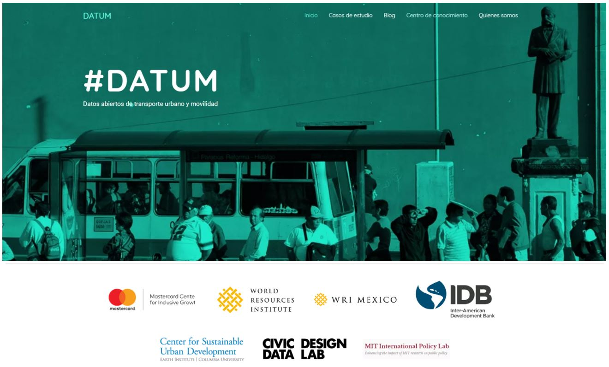
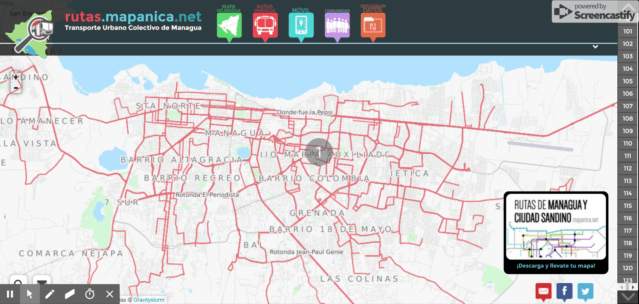
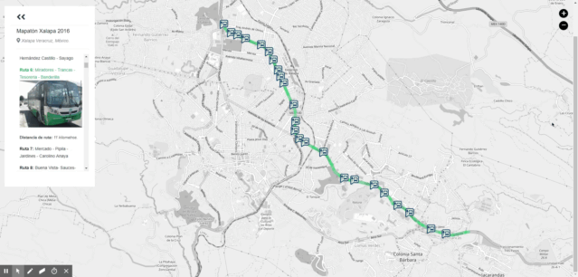
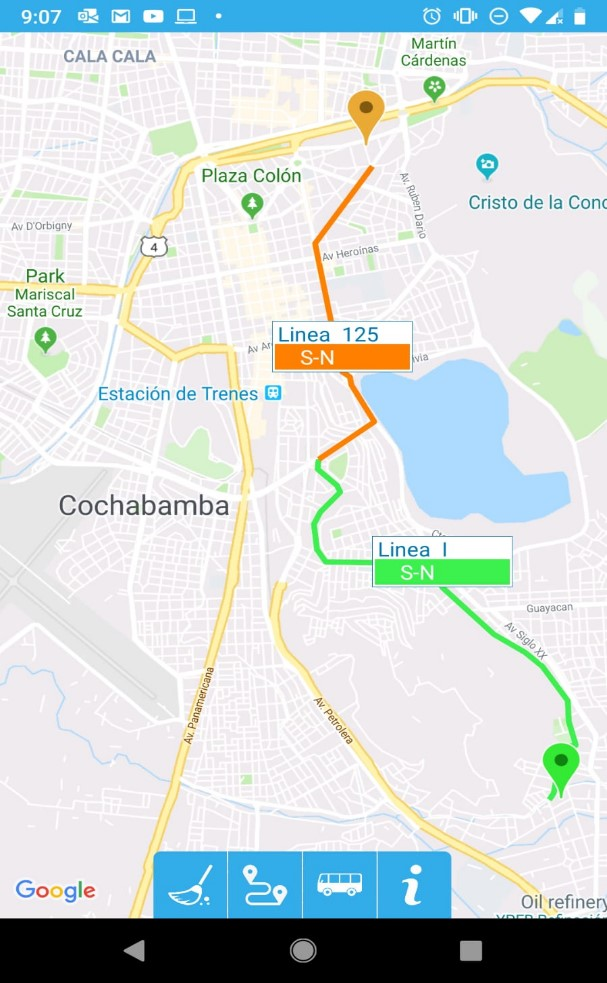
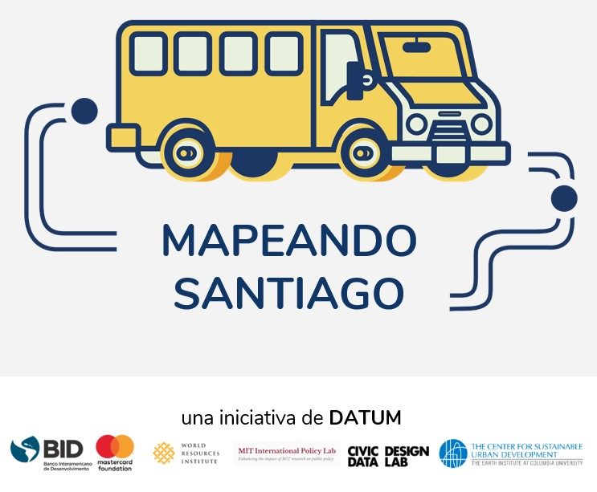

Este artículo fue originalmente publicado el 7 de junio del 2019 en el blog _Sustainable Cities_ del Banco Interamericano de Desarrollo. Desde entonces ya ha sido [archivado](https://web.archive.org/web/20260116182251/https://blogs.iadb.org/ciudades-sostenibles/es/datum-datos-abiertos-de-transporte-urbano-y-movilidad/) en ese blog y publicado aquí.

## Mapeo comunitario para ciudades más sostenibles
June 7, 2019 por Jordan Fischer - Edgar Lemus - Martin Quiroga - Patricio Zambrano Barragán Leave a Comment

Este artículo está también disponible en / This post is also available in: [Inglés](./2019-06-07-datum-eng.md)

En diversas ciudades de América Latina y el Caribe el transporte público juega un papel importante para que las personas puedan ir al trabajo y cumplir varias actividades cotidianas como ir de compras o recorrer la ciudad. Sin embargo, en la mayoría de los casos el transporte público en la región no cuenta con una información clara o accesible sobre las rutas y los horarios, obligando al usuario a solicitar direcciones y buscar otras alternativas para llegar a su destino.

Bien sabido es que los datos precisos y completos son la base de la planeación y toma de decisiones para mejorar el sistema de movilidad de una ciudad. El mapeo comunitario se presenta como una metodología eficiente para la construcción de rutas y optimización del transporte. Bajo esta forma, los residentes colaboran para generar datos sobre diferentes sistemas urbanos a partir de iniciativas de crowdsourcing (generación de datos en colaboración masiva).

¿De qué forma podemos facilitar la recolección de datos comunitarios y uso público en movilidad urbana? Desde la División de Vivienda y Desarrollo Urbano y Transporte del BID, en conjunto con socios estratégicos como WRI, MIT, Columbia University, y MasterCard, lanzamos DATUM, una plataforma regional que recopila experiencias previas, lecciones aprendidas y herramientas de código abierto como fuente central de información sobre proyectos de mapeo y movilidad urbana en la región. DATUM se presenta como una guía práctica para la recolección, procesamiento y diseminación de datos en movilidad urbana, que puede ser usado por las ciudades como herramienta para replicar proyectos de mapeo.

Algunas ciudades pioneras en América Latina y el Caribe ya han tenido experiencia y gran éxito en mapear sus sistemas de movilidad urbana con técnicas crowdsourcing y mapeo comunitario. Repasamos a continuación diferentes casos.

### MANAGUA, Nicaragua: MapaNica

MapaNica parte del OpenStreetMap en Nicaragua. Fue fundada en 2012 y provee datos abiertos y amigables al usuario sobre rutas de movilidad urbana para transitar por Managua usando transporte público, bicicleta, o a pie. El sitio web de código abierto, mapanica.net, provee datos detallados e interactivos que se mantienen actualizados por la comunidad diversa que contribuye al proyecto.

*Rutas mapeadas en la página web interactiva: MapaNica. MapaNica.net, 2017 OpenStreetMap. 2012*

### XALAPA, Mexico: MapMap

El transporte público de la capital de Veracruz fue mapeado en 2016 y 2017 usando una aplicación llamada MapMap. La iniciativa fue lanzada con un mapatón comunitario coordinado por Codeando Xalapa y el municipio de Xalapa, con apoyo metodológico del World Resource Institute (WRI) y OpenStreetMap. Las 162 rutas mapeadas se muestran en este [sitio web interactivo](https://mapaton.org/rutas/).

*Rutas mapeadas por la comunicad de Xalapa: mapathon. Codeando Xalapa, 2017.*

### COCHABAMBA, Bolivia: Cochala

Los sistemas altamente descentralizados de transporte de Cochabamba no eran efectivos y confundían a sus usuarios. De esta forma, nace la Guía Cochala en diciembre 2017, bajo la alianza de socios académicos, programadores, comunitarios, e internacionales, quienes mapearon rutas de movilidad a lo largo y ancho de la ciudad. Esta app ayuda a los usuarios a encontrar la ruta más eficiente entre dos puntos en la ciudad usando el transporte público. Con casi 10 mil descargas en los primeros 5 meses después de su lanzamiento, Guía Cochala promete revolucionar la experiencia del transporte público en Cochabamba. El éxito del proyecto llegó a alturas internacionales cuando los organizadores fueron contactados para incorporar los datos de movilidad que se habían recolectado en bases grandes como OpenStreetMap.

*La aplicación: Guia Cochala muestra una ruta optimizada. Guía Cochala, 2018.*

### SANTIAGO DE LOS CABALLEROS, República Dominicana: Mapeando Santiago

Para marcar el lanzamiento de DATUM, el Banco Interamericano de Desarrollo junto a sus socios han comenzado un piloto de mapeo comunitario en Santiago de los Caballeros, República Dominicana. Actualmente, Santiago no cuenta con información comprensiva y estandarizada sobre las rutas de transporte disponibles al público. Esto afecta la habilidad de los residentes de moverse en su ciudad, limitando su acceso a oportunidades de empleo, especialmente entre los residentes de bajos recursos.

La iniciativa Mapeando Santiago busca encontrar soluciones mapeando más de 60 rutas en el área metropolitana de Santiago de los Caballeros, incluyendo rutas interurbanas, usando datos abiertos y código abierto. El piloto se lleva a cabo en colaboración con las autoridades municipales de la ciudad, el Consejo para el Desarrollo Estratégico de Santiago (CDES), y la Pontificia Universidad Católica Madre y Maestra (PUCMM), además de los operadores y usuarios del transporte, y la sociedad civil.

Entre el 10 y el 28 de junio, estudiantes de PUCMM viajarán por la ciudad recolectando datos estandarizados, usando MapMap. Los estudiantes serán asignados a una ruta y documentarán el recorrido usando MapMap en sus dispositivos móviles para grabar el movimiento de datos GTFS. Una vez sea verificada la ruta, los datos serán recopilados en una central de datos para su posterior uso.

Los resultados de Mapeando Santiago serán compartidos con planeadores urbanos y autoridades de transporte para mejorar los servicios y políticas de transporte; con proveedores de servicios de mapas como Google Maps y Moovit para incorporarlos a sus bases de datos y con el público a través de la plataforma DATUM. A su vez, los resultados de Mapeando Santiago se presentarán en agosto del 2019, y los datos serán usados en el próximo hackatón patrocinado por el BID en la República Dominicana este año. Esto reforzará la capacidad local en datos GTFS y el análisis geoespacial que se fomentaron con el proyecto inicial.

[image not available]

Los **datos y softwares abiertos** permiten que los proyectos sean transparentes, además de mejorar el acceso a los datos. Un formato estandarizado [General Transit Feed Specification (GTFS)](https://en.wikipedia.org/wiki/GTFS#Structure) asegura que los datos sean compatibles con las aplicaciones y software usados en el campo de transporte, además de ser sostenibles ya que no esta atado a financiamiento externo.

La colaboración con comunidades locales ya establecidas – como OpenStreetMap, comunidades de programación, y la sociedad civil – puede asegurar que un proyecto sea útil y cumpla con las necesidades de los residentes. Trabajar con socios académicos y la participación de estudiantes capacitados para recolectar y procesar datos, aumenta también la sostenibilidad del proyecto, Mapeando Santiago servirá como precursor para futuros proyectos de mapeo comunitario realizados con el apoyo de DATUM.

View this post on Instagram

*A post shared by BID Ciudades Sostenibles (@bid_ciudades) on Jun 6, 2019 at 10:11am PDT*

#### Authors:

<html>
<head>
    <meta content="width=device-width, initial-scale=1.0">
    
</head>
<body>

    

        
        

            <h3 class="author-name">Jordan Jasuta Fischer</h3>
            
Jordan Jasuta Fischer trabaja en inteligencia artificial y análisis cognitivo en la división de sector público de IBM. Previamente, se especializaba en proyectos de código abierto, tecnología cívica y análisis geoespacial en Latinoamérica con el BID. Su experiencia en soluciones tecnológicas, gerencia de datos, y análisis avanzado en el campo del desarrollo internacional ha cubierto temas tan diversos como la administración pública, la salud pública, y los derechos humanos. Jordan tiene una maestría en Análisis de Negocios de la Universidad de George Washington y un bachillerato en Economía de la Universidad de Utah.

        

    

 

    

        
        

            <h3 class="author-name">Edgar Lemus</h3>
            
Edgar trabaja con mapas y tecnología cívica para ciudades. Con estudios en ciencia, política y manejo ambiental; en el BID explora estrategias para la innovación tecnológica en la administración pública de países en Latinoamérica y el Caribe. Específicamente a través de la implementación de soluciones de software abierto para análisis geoestadístico y para la mejora de las capacidades técnicas de gobiernos locales con el objetivo de reducir la brecha de información geográfica en la región y construir resiliencia ante el cambio climático.

        

    

 

    

        
        

            <h3 class="author-name">Martin Quiroga</h3>
            
Martín Quiroga Barrera Oro se incorporó al Banco Interamericano de Desarrollo en 2015, donde ha contribuido a la ejecución de proyectos en vivienda, desarrollo económico local, recuperación ambiental, revitalización urbana y movilidad. Anteriormente trabajó en monitoreo y evaluación en la Organización de Estados Americanos (OEA) y para un programa del Banco Mundial dirigido a mejorar los sistemas de salud pública a través de mecanismos de financiamiento basado en resultados. Es co-autor de “Pactos territoriales en la construcción de regiones transfronterizas: por una mayor integración a múltiples niveles”, entre otras publicaciones sobre fondos regionales, gobiernos locales y gobernanza. Martín ha impartido cursos de metodología de la investigación y política económica. Cuenta con una maestría en Políticas Públicas con orientación en Política Económica y ha sido becario de Fulbright, Brown University y Johns Hopkins University en cursos sobre estudios poblacionales, epidemiológicos y de desarrollo.

        

    

 

    

        
        

            <h3 class="author-name">Patricio Zambrano Barragán</h3>
            
Patricio Zambrano-Barragán trabajó como especialista senior en Desarrollo Urbano y Vivienda en el Banco Interamericano de Desarrollo (BID). Trabajó en varios países de América Latina y el Caribe en proyectos de politica y financiamiento de vivienda; infraestructura urbana resiliente; y análisis geospacial y de datos cívicos. Previamente, lideró proyectos de investigación sobre gestión territorial e infrastructura resiliente para el Massachusetts Institute of Technology y el Natural Resources Defense Council (NRDC). Ha trabajado en el Departamento de Desarrollo y Preservación de Vivienda de la Ciudad de Nueva York en programas de financiamiento de proyectos en riesgo; y como consultor para empresas de energía y telecomunicaciones. Patricio es actualmente candidato a PhD en Planificación Urbana en la Universidad de Pennsylvania, cuenta con una Maestría en Planificación Urbana y Regional del Massachusetts Institute of Technology y un Bachelor en ciencias políticas de la Universidad de Yale.

        

    

 

</body>
</html>

---
<!--
### Projects Overlay

To set what image links appear in the overlay menu edit `_data/projects.yaml`. Use the following format to set the URL, title, image and project status for as many links as you'd like. If you set `completed` to `false` like `completed: false`, it won't be clickable until you set it true like `completed: true`


- title: Moon Jekyll Theme
  url: http://taylantatli.me/Moon
  image: https://cloud.githubusercontent.com/assets/754514/14509720/61c61058-01d6-11e6-93ab-0918515ecd56.png
  completed: true

- title: Ramme Jekyll Theme
  url: http://taylantatli.me/Ramme
  image: https://raw.githubusercontent.com/TaylanTatli/Ramme/master/assets/img/screenshot-post.png
  completed: true

- title: Daisy Pelican Theme
  url: http://taylantatli.me/Daisy-Pelican-Theme/
  image: https://raw.githubusercontent.com/TaylanTatli/Daisy-Pelican-Theme/master/Preview-1.png
  completed: true

- title: Block Icon Theme
  url: https://github.com/TaylanTatli/Block-Icon-Theme
  image: https://raw.githubusercontent.com/TaylanTatli/Block-Icon-Theme/master/Preview.png
  completed: false

- title: Start Page
  url: http://taylantatli.me/StartPage/
  image: https://raw.githubusercontent.com/TaylanTatli/StartPage/master/preview.png
  completed: false


---
 -->
