This article was originally posted on June 10, 2019 to the Inter-American Development Bank blog _Sustainable Cities_. It has since been [archived](https://web.archive.org/web/20260113002055/https://blogs.iadb.org/ciudades-sostenibles/en/datum-open-transit-mapping-dominican-republic-santiago-caballeros/) on that blog and posted here.

# DATUM: a resource center for participatory urban transit mapping — The case of Santiago de los Caballeros

Este artículo está también disponible en / This post is also available in: Spanish


Growing urban populations in Latin American and Caribbean (LAC) cities put an enormous pressure on transport systems, especially in sprawling cities with increasingly far-flung residents. In this context it is essential to facilitate the design of public infrastructure in an efficient and participatory way.

Community mapping of urban infrastructure can play a central role. In 2019, to inform and encourage urban transit mapping, a consortium of partners – the IDB, WRI Mexico, MIT, Columbia University, and Mastercard – created DATUM, a platform that acts as a guide for collecting, processing, and publicizing urban mobility data. DATUM, or Datos Abiertos de Transporte Urbano y Movilidad (Open Urban Transport and Mobility Data), brings together lessons learned and open-source tools to facilitate projects in cities throughout the region, especially in places where those residents that depend on public transport don’t have clear information about routes and schedules.

### The Santiago de los Caballeros experience

To inaugurate the platform, DATUM supported a pilot mapping in Santiago de los Caballeros, Dominican Republic. Historically, Santiagueros didn’t have standardized information about public transportation routes. Neither Google Maps, nor Moovit, nor any other application or platform, be it global or local, could offer information on what bus or what route to take to get to work or leisure. This left residents reliant on informal methods like ‘word of mouth’ to get around.


Before the project began, Google Maps didn’t show any information on public transport


*After the DATUM pilot was implemented, Santiago de los Caballeros became the first city in the Caribbean where Google Maps can now provide public transport information*

And so, DATUM launched Mapeando Santiago in June 2019. The project includes trainings, public transit route mapping, GTFS data processing, and a complementary mapping of accessibility and security conditions for elderly and disabled residents that included participation from a number of local actors every step of the way.

### Participation as a basic principle

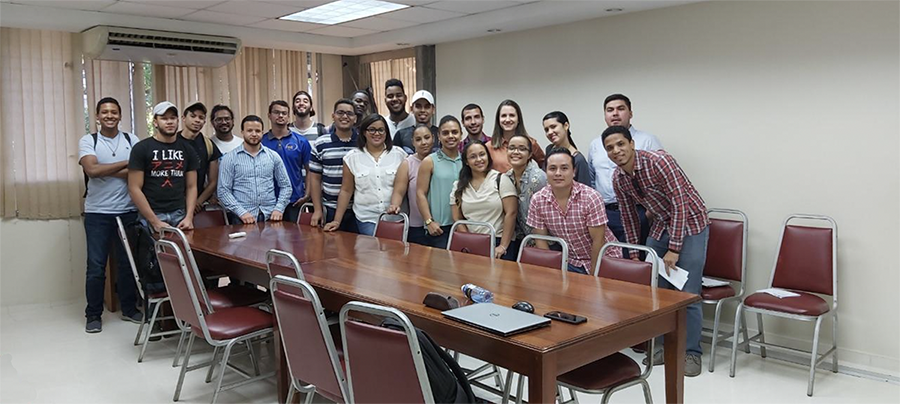
*Student volunteers from the Mapeando Santiago project. Source: IDB 2019*

The Mapeando Santiago project placed special attention on the participation of city residents and on understanding the needs of regular transport users. In collaboration with Santiago municipal authorities, CDES, the Catholic Pontific University Madre y Maestra (PUCMM),transport operators and users, and organizations representing disabled groups, the mapping was guaranteed to be a truly inclusive community project. The participation of local groups encourages the continuation of the project in the long term, builds local capacity, and allows services and policies to be designed at the local level.

### Mapping the routes

Thirty students from local universities were trained on the MapMap mobile app and best practices for the mapping exercise. The students – who came to the project from PUCMM, the Autonomous University of Santo Domingo, the Technological Univeristy of Santiago y la National Evangelical University – traveled along 29 urban routes and 25 off-shoots, and 6 interurban routes, recording georeferenced data on the routes and stops with the app.

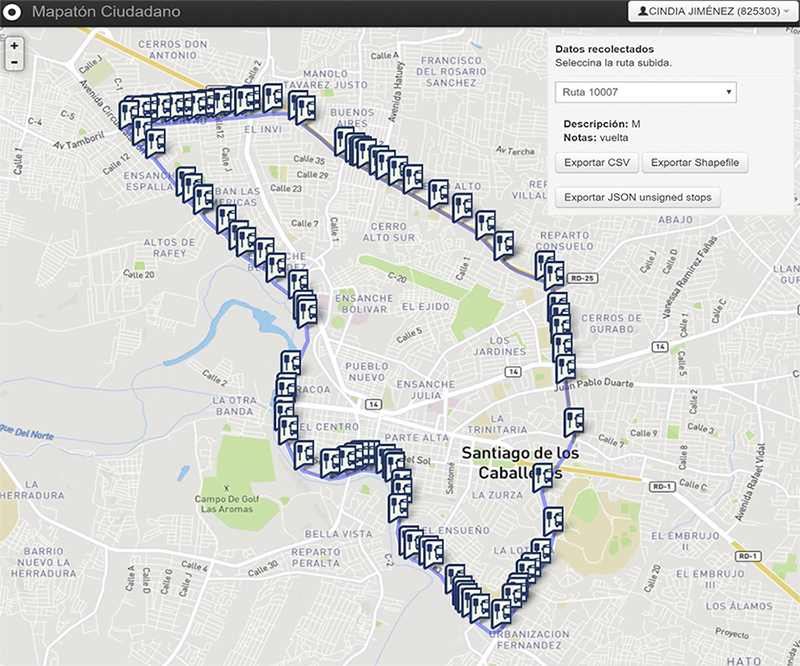
*Screenshot. Open-source app MapMap. Source: MapMap*

Another open-source app, Mapillary, was used to collect images of the public space along transport routes. In total, 120 trips were recorded and processed.

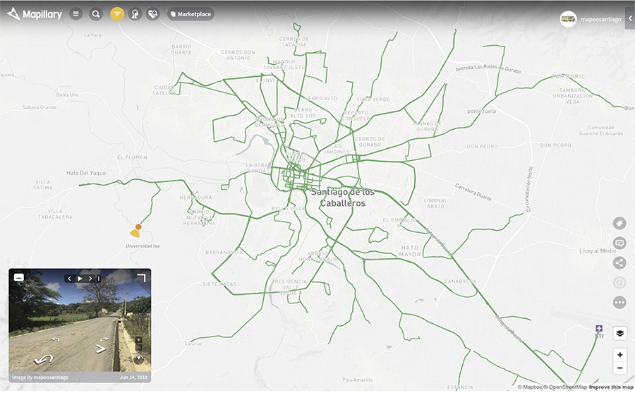
*Screenshot. Mapillary, an open-source app. Source: Mapillary*

The standard GTFS format allowed the data to be shared with Google Maps, which can now inform trips on public transport for the first time in the Caribbean.

### Accessibility and security in public transport

The need to collect information on public transport conditions and the importance of involving the community came together in the qualitative complementary mapping, which was realized along selected routes and the surrounding environment. Three techniques were used to assess the security and accessibility of public transport routes and user perceptions of the service:

1. A group of 7 students audited 3205 photos of the public space (streets and sidewalks) around 8 routes. 24 indicators were analyzed in each of the images collected   to produce maps and data that show what public spaces required intervention.

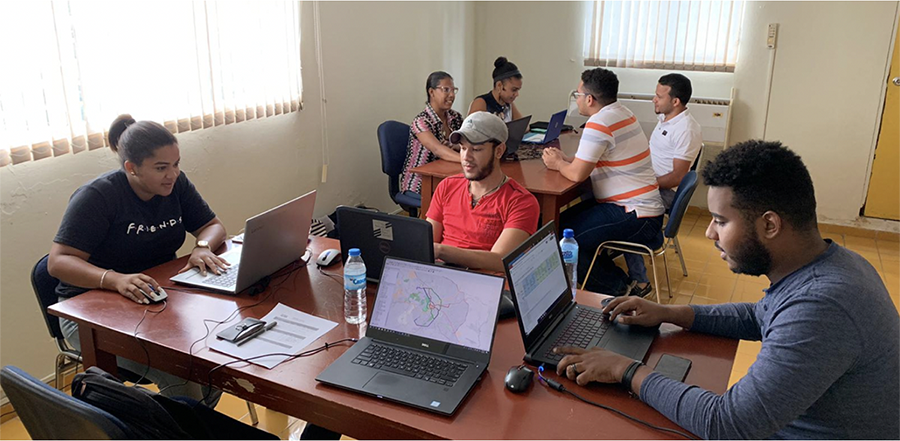
*Volunteers analyze 5 aspects of public space in each image: accessibility, perception of security, walkability, frequency of use and comfort. Source: IDB 2019*

2. Five civil society organizations accompanied DATUM organizers as walking focus groups to evaluate the accessibility and security conditions on the way to and from public transport. The following areas of the city were analyzed:

  - Cienfuegos, the area of the city where public transport is most used according to the Integral Plan for Sustainable Urban Mobility (PIMUS), also deals with problems like inadequate infrastructure and informal housing.

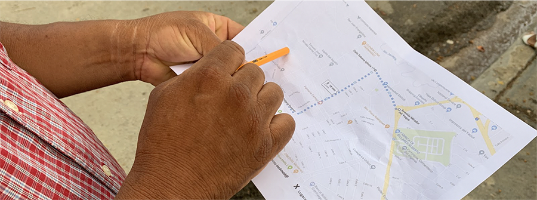
*In Cienfuegos, 12 members of community organizations evaluated security and accessibility. Source: IDB 2019*

  - In Los Pepines, a neighborhood where a school for the blind is located, accessibility was evaluated by 4 members of the Cibao Association of the Blind and 11 volunteers with visual disabilities.

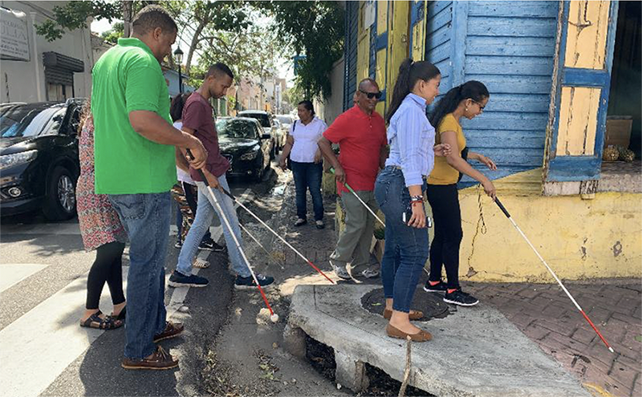
*Volunteers with visual disabilities identified obstacles and Shared mobility practices. Source: IDB 2019*

  - Additionally, 9 women, 1 man, and 1 child reviewed route security in the city center, the most common destination in the city, with a focus on gender issues.

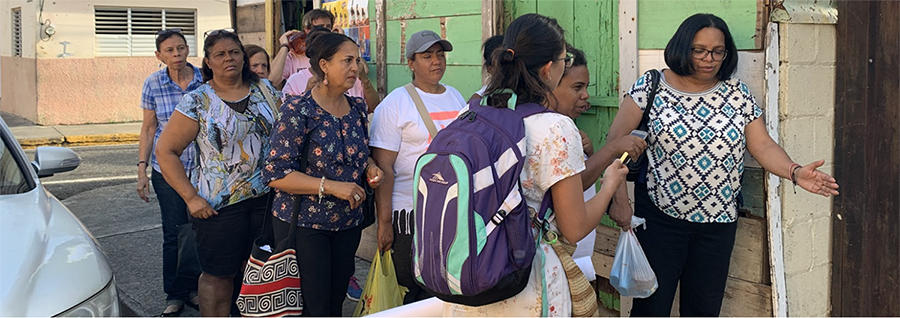
*Participants from the Fundación Mujer e Iglesia, the coordinator of the group Mujeres del Cibao and the Núcleo de Apoyo a la Mujer joined the initiative to review security in the city center*

3. A survey was circulated to better understand who uses public transportation, what they use it for, and how services can be improved from their perspective. The survey revealed the demography, mobility habits, and perceptions of public transportation of the respondents.

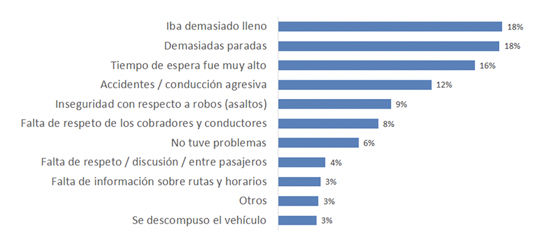
*500 survey responses were collected in the 3 weeks that the Survey was active*

The information collected in the complementary mapping will be shared on September 27 with all participants and authorities of Santiago for their use in decision making. The most eloquent result of the pilot was the launch the first map of urban routes in the city.

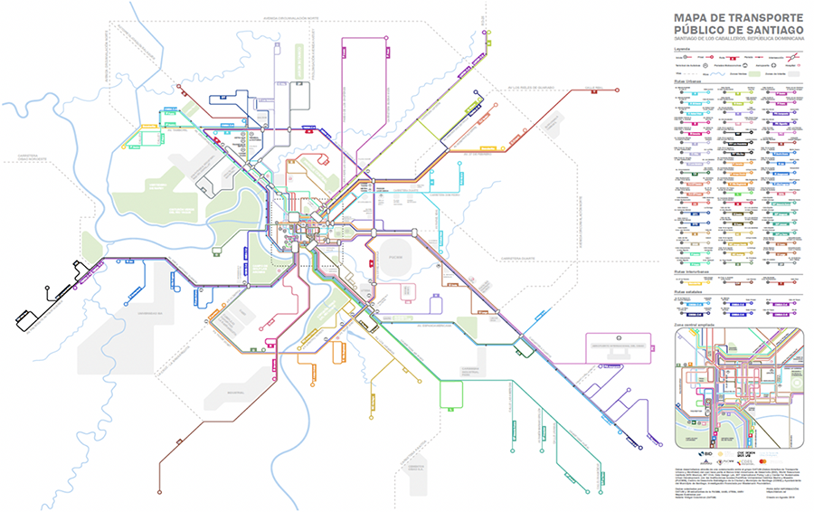
*Comprehensive map of urban transport routes in Santiago de los Caballeros*

### New experiences

Mapeando Santiago demonstrated a successful community mapping initiative using methodologies and tools suggested by DATUM. The results will tangibly improve the user experience on public transportation in Santiago, and the consistent involvement of community groups has left the city with well-trained and committed residents that will take up the monitoring, updating, and improvement of the mapping after its initial implementation.

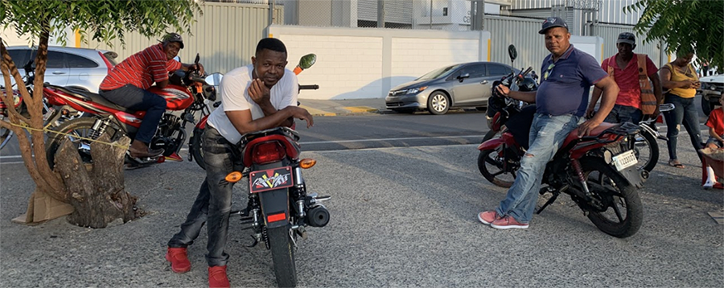

^The participation of ‘motoconcho’ (motorbike taxi) drivers and other transport providers contributed a unique and indispensable perspective to the project. Source: IDB 2019^

The experiences and results coming out of Mapeando Santiago will be presented at the closing event on Friday, September 27th. The data will be made available in the DATUM online portal, and for use in the IDB-sponsored hackathon that will be hosted in the Dominican Republic in the coming months, to reinforce local capacity using GTFS data and geospatial analysis.

From this experience, we at DATUM hope to involve more cities so that they can benefit from active citizen participation in the design of urban infrastructure. Learn more about partners’ experiences, suggested methodology, and open-source code for mapping and processing data at datum.la, our resource center for participatory urban transit mapping.


View this post on Instagram


*A post shared by BID Ciudades Sostenibles (@bid_ciudades) on Jun 6, 2019 at 10:11am PDT*


#### Autores Invitados:


<html>
<head>
    <meta content="width=device-width, initial-scale=1.0">
    <style>
        .author-box {
            display: flex;
            align-items: center;
            gap: 15px;
            background-color: #f9f9f9;
            border: 1px solid #e1e1e1;
            border-radius: 5px;
            padding: 15px;
            font-family: Arial, sans-serif;
            color: #333;
        }
        .author-avatar {
            width: 80px;
            height: 80px;
            border-radius: 50%;
            object-fit: cover;
            flex-shrink: 0;
            vertical-align: top;
        }
        .author-name {
            margin: 0 0 6px 0;
            font-size: 1.25rem;
            font-weight: bold;
        }
        .author-bio {
            margin: 0 0 12px 0;
            font-size: 0.95rem;
            line-height: 1.4;
            color: #555;
        }
        @media (max-width: 480px) {
            .author-box {
                flex-direction: column;
                text-align: center;
            }
        }
    </style>
</head>
<body>

    <div class="author-box">
        
        <div class="author-content">
            <h3 class="author-name">David Escalante</h3>
            <p class="author-bio">Transportation Planning and Operations Manager at WRI México. David has worked as consultant in urban mobility planning in Mexico, Brazil, Argentina, Colombia, Peru and Panamá, focused on public transport projects. He was Planning Deputy Manager and Technical Coordinator of the General Direction Office for the Mexico City’s Bus Rapid Transit (Metrobus). David is an expert in tansportation modeling, public transport planing, implementation of BRT corridors and evaluation of operational and financial performance of transport systems. David is a Transportation Engineer and has been a profesor at the National Polytechnic Institute in México</p>
        </div>
    </div>

<br>

    <div class="author-box">
        
        <div class="author-content">
            <h3 class="author-name">Tania Pérez</h3>
            <p class="author-bio">Tania Pérez: New Mobility Consultant, performs research, analysis and documentation of new mobility models to accompany cities in their understanding and possible regulation. She has experience as a public transport consultant at the Institute of Transportation and Development Policies. She has a degree in Industrial Design.</p>
        </div>
    </div>

<br>

    <div class="author-box">
        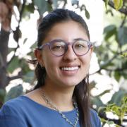
        <div class="author-content">
            <h3 class="author-name">Ana María Martínez</h3>
            <p class="author-bio">Consultant for WRI in the area of ​​Science and research.</p>
        </div>
    </div>

<br>

    <div class="author-box">
        
        <div class="author-content">
            <h3 class="author-name">Jordan Jasuta Fischer</h3>
            <p class="author-bio">Jordan Jasuta Fischer trabaja en inteligencia artificial y análisis cognitivo en la división de sector público de IBM. Previamente, se especializaba en proyectos de código abierto, tecnología cívica y análisis geoespacial en Latinoamérica con el BID. Su experiencia en soluciones tecnológicas, gerencia de datos, y análisis avanzado en el campo del desarrollo internacional ha cubierto temas tan diversos como la administración pública, la salud pública, y los derechos humanos. Jordan tiene una maestría en Análisis de Negocios de la Universidad de George Washington y un bachillerato en Economía de la Universidad de Utah.</p>
        </div>
    </div>

<br>

    <div class="author-box">
        
        <div class="author-content">
            <h3 class="author-name">Patricio Zambrano Barragán</h3>
            <p class="author-bio">Patricio Zambrano-Barragán was a Housing and Urban Development Specialist at the Inter-American Development Bank. He currently led urban development projects throughout Latin America and the Caribbean, including housing policy and finance projects; resilient urban infrastructure; and geospatial and civic data analytics. Prior to joining the IDB, he led research on territorial management and climate-ready infrastructure at the Massachusetts Institute of Technology and the Natural Resources Defense Council (NRDC). Patricio has worked with the Office of the Deputy Mayor in Quito, Ecuador; with the New York City Department of Housing Preservation and Development (HPD) on distressed asset financing; and as a management consultant with New York-based Katzenbach Partners. Patricio is a doctoral candidate in City and Regional Planning at the University of Pennsylvania, and holds a Master's in City and Regional Planning from the Massachusetts Institute of Technology and a B.A. in Political Science from Yale University.</p>
        </div>
    </div>

<br>

    <div class="author-box">
        
        <div class="author-content">
            <h3 class="author-name">Edgar Lemus</h3>
            <p class="author-bio">Edgar is a map-maker and civic technologist with a background in Environmental Science, Policy and Management. At the IDB, he explores strategies in public service innovation in Latin America and the Caribbean. Particularly, through the deployment of open software for geostatistical analysis to improve the technical capacities of local governments, bridge the geographic data gap in the region, and build climate change resiliency.</p>
        </div>
    </div>

<br>

    <div class="author-box">
        
        <div class="author-content">
            <h3 class="author-name">Natalia Vidigal Coachman</h3>
            <p class="author-bio">Natalia Coachman is a Housing and Urban Development Consultant at the Inter-American Development Bank. Previously, she worked as an urban consultant for the World Bank Group, as a researcher for MIT CoLab and Civic Data Design Lab, and as an architect leading projects in diverse Latin American Countries. Natalia holds a Master’s in City Planning from Massachusetts Institute of Technology and a B.A. in Architecture and Urbanism from Escola da Cidade de Sao Paulo.</p>
        </div>
    </div>

<br>

</body>
</html>


```
David Escalante: Transportation Planning and Operations Manager at WRI México. David has worked as consultant in urban mobility planning in Mexico, Brazil, Argentina, Colombia, Peru and Panamá, focused on public transport projects. He was Planning Deputy Manager and Technical Coordinator of the General Direction Office for the Mexico City’s Bus Rapid Transit (Metrobus). David is an expert in tansportation modeling, public transport planing, implementation of BRT corridors and evaluation of operational and financial performance of transport systems. David is a Transportation Engineer and has been a profesor at the National Polytechnic Institute in México
```

```
Tania Pérez: New Mobility Consultant, performs research, analysis and documentation of new mobility models to accompany cities in their understanding and possible regulation. She has experience as a public transport consultant at the Institute of Transportation and Development Policies. She has a degree in Industrial Design.
```


```
Ana María Martínez: Consultant for WRI in the area of ​​Science and research.
```


```
Jordan Fischer
Jordan Jasuta Fischer trabaja en inteligencia artificial y análisis cognitivo en la división de sector público de IBM. Previamente, se especializaba en proyectos de código abierto, tecnología cívica y análisis geoespacial en Latinoamérica con el BID. Su experiencia en soluciones tecnológicas, gerencia de datos, y análisis avanzado en el campo del desarrollo internacional ha cubierto temas tan diversos como la administración pública, la salud pública, y los derechos humanos. Jordan tiene una maestría en Análisis de Negocios de la Universidad de George Washington y un bachillerato en Economía de la Universidad de Utah.
```

```
Patricio Zambrano Barragán
Patricio Zambrano-Barragán was a Housing and Urban Development Specialist at the Inter-American Development Bank. He currently led urban development projects throughout Latin America and the Caribbean, including housing policy and finance projects; resilient urban infrastructure; and geospatial and civic data analytics. Prior to joining the IDB, he led research on territorial management and climate-ready infrastructure at the Massachusetts Institute of Technology and the Natural Resources Defense Council (NRDC). Patricio has worked with the Office of the Deputy Mayor in Quito, Ecuador; with the New York City Department of Housing Preservation and Development (HPD) on distressed asset financing; and as a management consultant with New York-based Katzenbach Partners. Patricio is a doctoral candidate in City and Regional Planning at the University of Pennsylvania, and holds a Master's in City and Regional Planning from the Massachusetts Institute of Technology and a B.A. in Political Science from Yale University.
```

```
Edgar Lemus
Edgar is a map-maker and civic technologist with a background in Environmental Science, Policy and Management. At the IDB, he explores strategies in public service innovation in Latin America and the Caribbean. Particularly, through the deployment of open software for geostatistical analysis to improve the technical capacities of local governments, bridge the geographic data gap in the region, and build climate change resiliency.
```

```
Natalia Vidigal Coachman
Natalia Coachman is a Housing and Urban Development Consultant at the Inter-American Development Bank. Previously, she worked as an urban consultant for the World Bank Group, as a researcher for MIT CoLab and Civic Data Design Lab, and as an architect leading projects in diverse Latin American Countries. Natalia holds a Master’s in City Planning from Massachusetts Institute of Technology and a B.A. in Architecture and Urbanism from Escola da Cidade de Sao Paulo.
```


---
<!--
### Projects Overlay

To set what image links appear in the overlay menu edit `_data/projects.yaml`. Use the following format to set the URL, title, image and project status for as many links as you'd like. If you set `completed` to `false` like `completed: false`, it won't be clickable until you set it true like `completed: true`


- title: Moon Jekyll Theme
  url: http://taylantatli.me/Moon
  image: https://cloud.githubusercontent.com/assets/754514/14509720/61c61058-01d6-11e6-93ab-0918515ecd56.png
  completed: true

- title: Ramme Jekyll Theme
  url: http://taylantatli.me/Ramme
  image: https://raw.githubusercontent.com/TaylanTatli/Ramme/master/assets/img/screenshot-post.png
  completed: true

- title: Daisy Pelican Theme
  url: http://taylantatli.me/Daisy-Pelican-Theme/
  image: https://raw.githubusercontent.com/TaylanTatli/Daisy-Pelican-Theme/master/Preview-1.png
  completed: true

- title: Block Icon Theme
  url: https://github.com/TaylanTatli/Block-Icon-Theme
  image: https://raw.githubusercontent.com/TaylanTatli/Block-Icon-Theme/master/Preview.png
  completed: false

- title: Start Page
  url: http://taylantatli.me/StartPage/
  image: https://raw.githubusercontent.com/TaylanTatli/StartPage/master/preview.png
  completed: false


---
 -->
