Este artículo fue originalmente publicado el 10 de junio del 2019 al blog _Sustainable Cities_ del Banco Interamericano de Desarrollo. Desde entonces ya ha sido [archivado](https://web.archive.org/web/20260113002055/https://blogs.iadb.org/ciudades-sostenibles/en/datum-open-transit-mapping-dominican-republic-santiago-caballeros/) en ese blog y publicado aquí.

## The case of Santiago de los Caballeros

Este artículo está también disponible en / This post is also available in: [Inglés](./2019-06-10-datum-santiago-caballeros-eng.md)

El crecimiento urbano y poblacional de las ciudades de América Latina y el Caribe (ALC) pone una enorme presión a los sistemas de transporte, especialmente en ciudades poco densas donde los residentes viven en lugares cada vez más dispersos. Por eso, es esencial facilitar un diseño de infraestructura pública de modo eficiente y participativo.

El mapeo comunitario de infraestructura urbana puede jugar un rol protagónico en este aspecto. Es aquí la importancia de contar con un centro de recursos para el mapeo participativo de tránsito urbano. En el 2019, para informar y fomentar el mapeo de tránsito urbano, un consorcio de socios – el BID, WRI, MIT, Columbia University, y MasterCard – crearon DATUM, una plataforma que actúa como guía para la recolección, procesamiento, y promulgación de los datos de movilidad urbana. DATUM, o Datos Abiertos de Transporte Urbano y Movilidad, junta lecciones aprendidas y herramientas de código abierto para facilitar proyectos en ciudades de la región, especialmente en lugares donde los residentes que dependen del transporte público no tienen información clara sobre rutas y horarios.

> ¿Cuenta tu ciudad con información clara y accesible sobre las rutas y horarios del transporte público
> urbano? Vota y conoce el rol clave del mapeo comunitario 🗺️ https://t.co/WbbXgOlpu7 #OpenData
> #DatosAbiertos #crowdsourcing
>
> — BID Ciudades Sostenibles (@BID_Ciudades) July 1, 2019

### La experiencia en Santiago de los Caballeros

Para inaugurar la plataforma, DATUM facilitó un mapeo piloto en Santiago de los Caballeros, República Dominicana. Históricamente, los Santiagueros no contaban con información estandarizada de las rutas del transporte público. Aplicaciones y plataforma, globales o locales, como Google Maps, Moovit, entre otras no ofrecían información sobre el transporte público o rutas para los viajes del trabajo y ocio. Esta situación obligaba a los residentes a usar medios informales de comunicación como el ‘boca a boca’ para movilizarse.

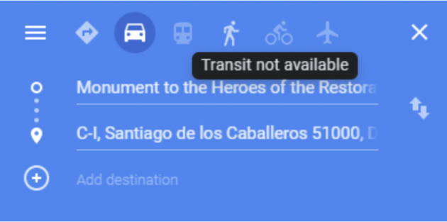

*Antes de iniciar el proyecto, Google Maps no contaba con información sobre el transporte público.*

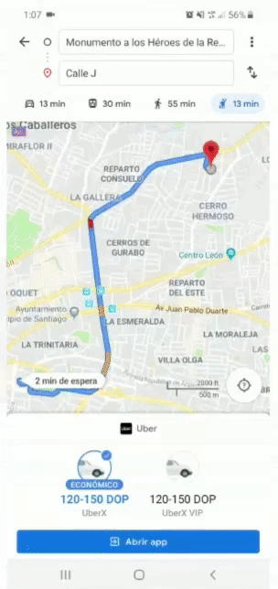

*Luego de la implementación de DATUM, Santiago de los Caballeros se convierte en la primera ciudad del Caribe donde Google Maps cuenta con información sobre transporte público.*

Así es que desde DATUM se lanzó Mapeando Santiago en junio del 2019. El proyecto incluyó capacitaciones, mapeo de las rutas de transporte público, procesamiento de datos GTFS, y un mapeo complementario de accesibilidad y condiciones de seguridad para ancianos y discapacitados, con la participación de numerosos actores locales a cada paso.

### La participación como principio base

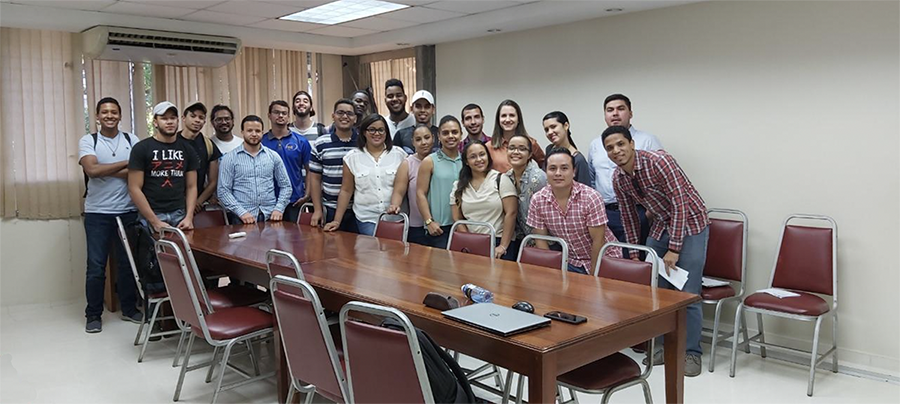

*Estudiantes voluntarios del proyecto Mapeando Santiago. Fuente: BID 2019*

En el proyecto de Mapeando Santiago, se puso especial atención en la participación de los ciudadanos y en entender las necesidades de los usuarios de transporte regulares. En conjunto con las autoridades municipales de Santiago, CDES, la Pontificia Universidad Católica Madre y Maestra (PUCMM), operadores y usuarios de transporte, y organizaciones representativas de grupos discapacitados, se garantizó que el mapeo fuera un proyecto verdaderamente comunitario e inclusivo. La participación de grupos locales fomenta la continuación a largo plazo del proyecto, construye capacidades y permite que los servicios sean diseñados a nivel local.

### Mapeo de rutas

Treinta estudiantes de universidades locales fueron capacitados en el uso de la aplicación  MapMap y cuáles eran las mejores prácticas para el ejercicio. Los estudiantes – que venían de la PUCMM, Universidad Autónoma de Santo Domingo, la Universidad Tecnológica de Santiago y la Universidad Nacional Evangélica– recorrieron 29 rutas y 25 ramales de rutas urbanas, y 6 rutas interurbanas, registrando datos georeferenciados de las rutas y sus paradas con la aplicación.

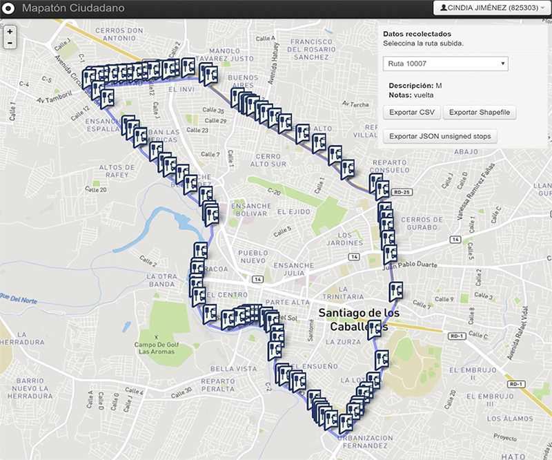

*Captura de Pantalla. MapMap, aplicación de código abierto. Fuente: MapMap*

Otra aplicación de código abierto, Mapillary, se usó para recolectar imágenes del espacio público a lo largo de las rutas de transporte. En total, 120 recorridos fueron registrados y procesados.

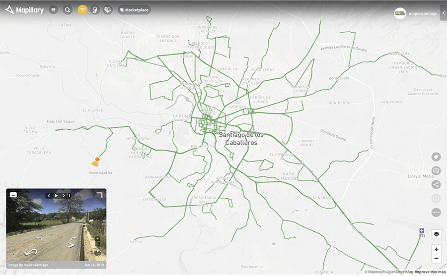

*Captura de Pantalla. Mapillary, aplicación de código abierto. Fuente: Mapillary*

El formato estandar GTFS permitió que los datos fueran compartidos con Google Maps, que ahora puede facilitar la planeación de viajes en transporte público por primera vez en el Caribe.

### Accesibilidad y seguridad del transporte

La necesidad de recolectar información sobre las condiciones del transporte público y la importancia de involucrar a la comunidad se juntaron en el mapeo complementario cualitativo, que se realizó a lo largo de varias rutas y el entorno a través del cual los usuarios tienen que pasar para acceder a estas.  Se emplearon 3 técnicas de evaluación para determinar la seguridad y accesibilidad del entorno de las rutas de transporte público y la percepción de los usuarios del servicio:

1. Un grupo de 7 estudiantes auditaron 3205 fotos del espacio público (calles y aceras) alrededor de 8 rutas. Se analizaron 24 indicadores en cada una de las imágenes recolectadas con Mapillary para producir mapas y datos que muestran los espacios públicos que requieren intervención.

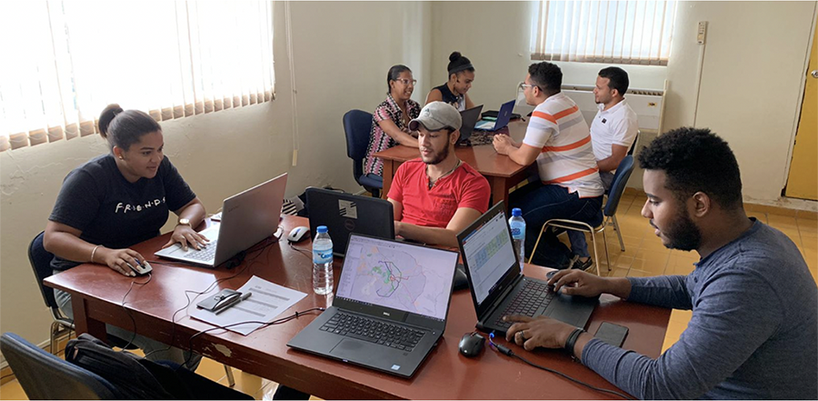

*Voluntarios analizaron 5 atributos del espacio público en cada imagen: accesibilidad, percepción de seguridad, caminabilidad, frecuentación y comodidad. Fuente: BID 2019*

2. Cinco organizaciones de la sociedad civil acompañaron a los organizadores de como grupos focales transeuntes para evaluar las condiciones de acceso y seguridad en los recorridos hacia y desde transporte público. Areas de la ciudad analizadas:

  - Cienfuegos, área de la ciudad donde más se usa el transporte público según el Plan Integral de Movilidad Urbana Sostenible (PIMUS), también lidia con problemas como infraestructura inadecuada y vivienda informal.

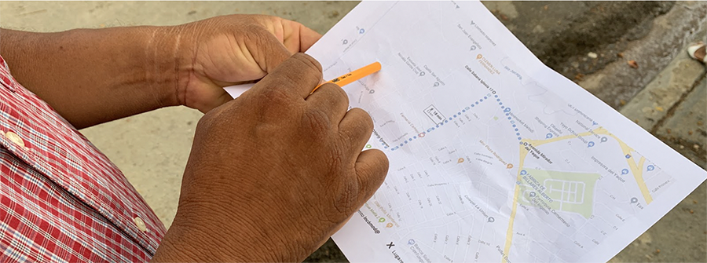

*En Cienfuegos, 12 miembros de organizaciones comunitarias evaluaron temas de seguridad y acceso. Fuente: BID 2019*

  - En Los Pepines, un barrio con una escuela para ciegos, la accesibilidad fue evaluada por 4 miembros de la Asociación de Ciegos del Cibao y 11 voluntarios con discapacidad visual.

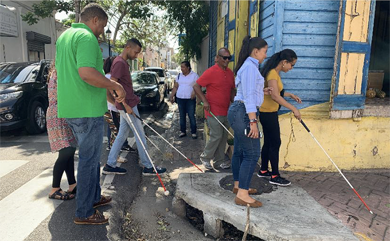

*Los voluntarios con discapacidad visual identificaron obstáculos y compartieron sus prácticas de movilidad. Fuente: BID 2019*

  - Adicionalmente, 9 mujeres, 1 hombre, y un niño revisaron la seguridad de rutas en el centro de la ciudad, el destino donde terminan más viajes en la ciudad, con enfoque de género.

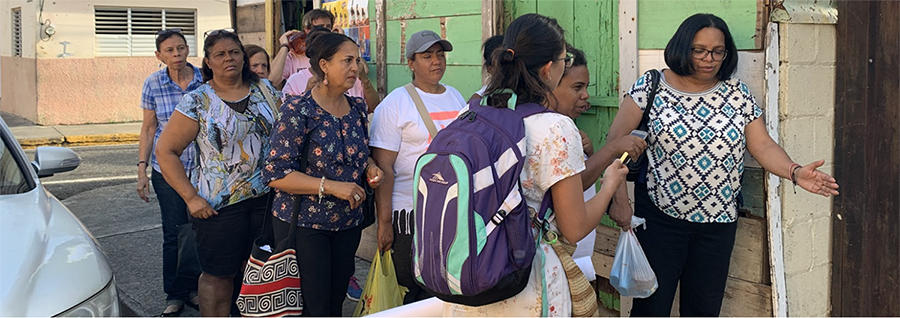

*Se sumaron participantes de la Fundación Mujer e Iglesia, la coordinadora del grupo Mujeres del Cibao y el Núcleo de Apoyo a la Mujer para revisar la seguridad en el centro. Fuente: BID 2019*

3. Una encuesta fue difundida para entender mejor quiénes usan el transporte público, para qué lo usan, y cómo se puede mejorar su servicio desde su perspectiva. La encuesta reveló la demografía, hábitos de movilidad y las percepciones sobre el transporte público de los encuestados

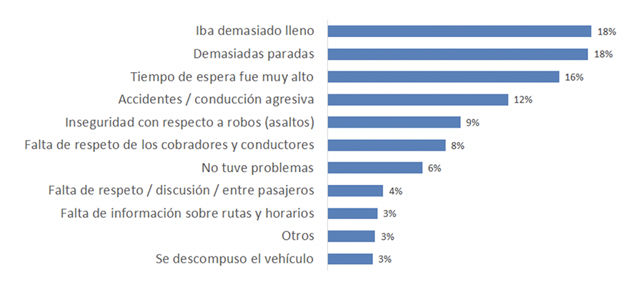

*Se colectaron 500 respuestas a la encuesta en las 3 semanas que estuvo activa.*

La información levantada en el mapeo complementario será compartida el 27 de septiembre con todos los participantes y con las autoridades de Santiago para su uso en la toma de decisiones. El resultado más elocuente es el lanzamiento del primer mapa de rutas urbanas de la ciudad.

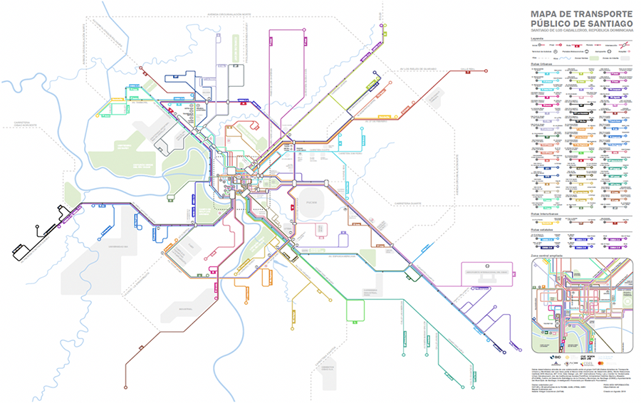

*Mapa comprensivo de rutas urbanas en Santiago de los Caballeros. Fuente: BID 2019*

### Nuevas experiencias

DATUM: un centro de recursos para el mapeo participativo de tránsito urbano — El caso de Santiago de los Caballeros
September 20, 2019 por Jordan Fischer - Patricio Zambrano Barragán - Edgar Lemus - Natalia Vidigal Coachman 1 Comentario

Este artículo está también disponible en / This post is also available in: Inglés

El crecimiento urbano y poblacional de las ciudades de América Latina y el Caribe (ALC) pone una enorme presión a los sistemas de transporte, especialmente en ciudades poco densas donde los residentes viven en lugares cada vez más dispersos. Por eso, es esencial facilitar un diseño de infraestructura pública de modo eficiente y participativo.

El mapeo comunitario de infraestructura urbana puede jugar un rol protagónico en este aspecto. Es aquí la importancia de contar con un centro de recursos para el mapeo participativo de tránsito urbano. En el 2019, para informar y fomentar el mapeo de tránsito urbano, un consorcio de socios – el BID, WRI, MIT, Columbia University, y MasterCard – crearon DATUM, una plataforma que actúa como guía para la recolección, procesamiento, y promulgación de los datos de movilidad urbana. DATUM, o Datos Abiertos de Transporte Urbano y Movilidad, junta lecciones aprendidas y herramientas de código abierto para facilitar proyectos en ciudades de la región, especialmente en lugares donde los residentes que dependen del transporte público no tienen información clara sobre rutas y horarios.

¿Cuenta tu ciudad con información clara y accesible sobre las rutas y horarios del transporte público urbano? Vota y conoce el rol clave del mapeo comunitario 🗺️ https://t.co/WbbXgOlpu7 #OpenData #DatosAbiertos #crowdsourcing

— BID Ciudades Sostenibles (@BID_Ciudades) July 1, 2019

La experiencia en Santiago de los Caballeros

Para inaugurar la plataforma, DATUM facilitó un mapeo piloto en Santiago de los Caballeros, República Dominicana. Históricamente, los Santiagueros no contaban con información estandarizada de las rutas del transporte público. Aplicaciones y plataforma, globales o locales, como Google Maps, Moovit, entre otras no ofrecían información sobre el transporte público o rutas para los viajes del trabajo y ocio. Esta situación obligaba a los residentes a usar medios informales de comunicación como el ‘boca a boca’ para movilizarse.

Antes de iniciar el proyecto, Google Maps no contaba con información sobre el transporte público.

Luego de la implementación de DATUM, Santiago de los Caballeros se convierte en la primera ciudad del Caribe donde Google Maps cuenta con información sobre transporte público.
Así es que desde DATUM se lanzó Mapeando Santiago en junio del 2019. El proyecto incluyó capacitaciones, mapeo de las rutas de transporte público, procesamiento de datos GTFS, y un mapeo complementario de accesibilidad y condiciones de seguridad para ancianos y discapacitados, con la participación de numerosos actores locales a cada paso.

La participación como principio base

Estudiantes voluntarios del proyecto Mapeando Santiago. Fuente: BID 2019
En el proyecto de Mapeando Santiago, se puso especial atención en la participación de los ciudadanos y en entender las necesidades de los usuarios de transporte regulares. En conjunto con las autoridades municipales de Santiago, CDES, la Pontificia Universidad Católica Madre y Maestra (PUCMM), operadores y usuarios de transporte, y organizaciones representativas de grupos discapacitados, se garantizó que el mapeo fuera un proyecto verdaderamente comunitario e inclusivo. La participación de grupos locales fomenta la continuación a largo plazo del proyecto, construye capacidades y permite que los servicios sean diseñados a nivel local.

Mapeo de rutas

Treinta estudiantes de universidades locales fueron capacitados en el uso de la aplicación  MapMap y cuáles eran las mejores prácticas para el ejercicio. Los estudiantes – que venían de la PUCMM, Universidad Autónoma de Santo Domingo, la Universidad Tecnológica de Santiago y la Universidad Nacional Evangélica– recorrieron 29 rutas y 25 ramales de rutas urbanas, y 6 rutas interurbanas, registrando datos georeferenciados de las rutas y sus paradas con la aplicación.

Captura de Pantalla. MapMap, aplicación de código abierto. Fuente: MapMap
Otra aplicación de código abierto, Mapillary, se usó para recolectar imágenes del espacio público a lo largo de las rutas de transporte. En total, 120 recorridos fueron registrados y procesados.

Captura de Pantalla. Mapillary, aplicación de código abierto. Fuente: Mapillary
El formato estandar GTFS permitió que los datos fueran compartidos con Google Maps, que ahora puede facilitar la planeación de viajes en transporte público por primera vez en el Caribe.

Accesibilidad y seguridad del transporte

La necesidad de recolectar información sobre las condiciones del transporte público y la importancia de involucrar a la comunidad se juntaron en el mapeo complementario cualitativo, que se realizó a lo largo de varias rutas y el entorno a través del cual los usuarios tienen que pasar para acceder a estas.  Se emplearon 3 técnicas de evaluación para determinar la seguridad y accesibilidad del entorno de las rutas de transporte público y la percepción de los usuarios del servicio:

Un grupo de 7 estudiantes auditaron 3205 fotos del espacio público (calles y aceras) alrededor de 8 rutas. Se analizaron 24 indicadores en cada una de las imágenes recolectadas con Mapillary para producir mapas y datos que muestran los espacios públicos que requieren intervención.

Voluntarios analizaron 5 atributos del espacio público en cada imagen: accesibilidad, percepción de seguridad, caminabilidad, frecuentación y comodidad. Fuente: BID 2019
Cinco organizaciones de la sociedad civil acompañaron a los organizadores de como grupos focales transeuntes para evaluar las condiciones de acceso y seguridad en los recorridos hacia y desde transporte público. Areas de la ciudad analizadas:
Cienfuegos, área de la ciudad donde más se usa el transporte público según el Plan Integral de Movilidad Urbana Sostenible (PIMUS), también lidia con problemas como infraestructura inadecuada y vivienda informal.

En Cienfuegos, 12 miembros de organizaciones comunitarias evaluaron temas de seguridad y acceso. Fuente: BID 2019
En Los Pepines, un barrio con una escuela para ciegos, la accesibilidad fue evaluada por 4 miembros de la Asociación de Ciegos del Cibao y 11 voluntarios con discapacidad visual.

Los voluntarios con discapacidad visual identificaron obstáculos y compartieron sus prácticas de movilidad. Fuente: BID 2019
Adicionalmente, 9 mujeres, 1 hombre, y un niño revisaron la seguridad de rutas en el centro de la ciudad, el destino donde terminan más viajes en la ciudad, con enfoque de género.

Se sumaron participantes de la Fundación Mujer e Iglesia, la coordinadora del grupo Mujeres del Cibao y el Núcleo de Apoyo a la Mujer para revisar la seguridad en el centro. Fuente: BID 2019
Una encuesta fue difundida para entender mejor quiénes usan el transporte público, para qué lo usan, y cómo se puede mejorar su servicio desde su perspectiva. La encuesta reveló la demografía, hábitos de movilidad y las percepciones sobre el transporte público de los encuestados

Se colectaron 500 respuestas a la encuesta en las 3 semanas que estuvo activa.
La información levantada en el mapeo complementario será compartida el 27 de septiembre con todos los participantes y con las autoridades de Santiago para su uso en la toma de decisiones. El resultado más elocuente es el lanzamiento del primer mapa de rutas urbanas de la ciudad.

Mapa comprensivo de rutas urbanas en Santiago de los Caballeros. Fuente: BID 2019
Nuevas experiencias

Mapeando Santiago ha demostrado un exitoso mapeo comunitario usando metodologías y herramientas sugeridas por DATUM. Los resultados mejorarán de manera tangible la experiencia de los usuarios del transporte público en Santiago, y el involucramiento consistente de grupos comunitarios ha dejado la ciudad con residentes bien capacitados y comprometidos. Estos, se encargarán del monitoreo, actualización, y mejora del mapeo luego de su implementación inicial.

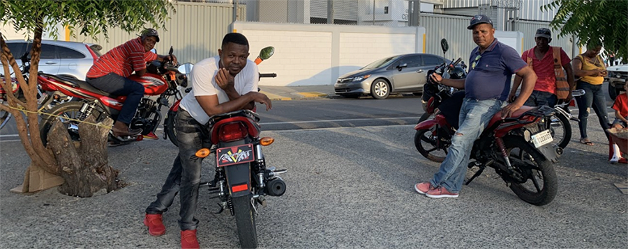

*La participación de los conductores de ‘motoconchos’ y otros proveedores de transporte contribuyó una perspectiva única e imprescindible al proyecto. Fuente: BID 2019*

Las experiencias y los resultados de Mapeando Santiago se presentarán en el evento final el viernes 27 de septiembre. Los datos se harán disponibles adicionalmente en el portal de DATUM, y para uso en el hackatón patrocinado por el BID en Republica Dominicana en los próximos meses, para reforzar la capacidad local con datos GTFS y el análisis geoespacial.

A partir de esta experiencia, desde DATUM esperamos involucrar a más ciudades para que se pueda contar con participación activa de la población en del diseño de infraestructura urbana. Aprenda más sobre las experiencias de los socios, metodologías sugeridas, y herramientas de código abierto para el mapeo comunitario urbano y procesar datos en datum.la.

View this post on Instagram

*A post shared by BID Ciudades Sostenibles (@bid_ciudades) on Jun 6, 2019 at 10:11am PDT*

#### Autores Invitados:

<html>
<head>
    <meta content="width=device-width, initial-scale=1.0">
    
</head>
<body>

    

        
        

            <h3 class="author-name">David Escalante</h3>
            
Gerente de Planificación y Operaciones de Transporte en WRI México. Ha trabajado como consultor en planeación de movilidad urbana en México, Brasil, Argentina, Colombia, Perú y Panamá, enfocado en proyectos de transporte público. También fue Subgerente de Planeación en el Metrobús de la Ciudad de México y como Coordinador Técnico en la Dirección General de Metrobus. David es especialista en modelos de transporte, planeación de sistemas de transporte urbano, implementación de corredores BRT y evaluación del desempeño operativo y financiero de los sistemas de transporte. David es Ingeniero en Transporte y ha sido profesor del Instituto Politécnico Nacional.

        

    

 

    

        
        

            <h3 class="author-name">Tania Pérez</h3>
            
Consultora de Nueva Movilidad, realiza investigación, análisis y documentación de los nuevos modelos de movilidad para acompañar a las ciudades en su entendimiento y posible regulación. Tiene experiencia como consultora de transporte público en el Instituto de Políticas para el Transporte y el Desarrollo. Es Licenciada en Diseño Industrial.

        

    

 

    

        
        

            <h3 class="author-name">Ana María Martínez</h3>
            
Consultora para WRI en el área de Ciencia e investigación.

        

    

 

    

        
        

            <h3 class="author-name">Jordan Jasuta Fischer</h3>
            
Jordan Jasuta Fischer trabaja en inteligencia artificial y análisis cognitivo en la división de sector público de IBM. Previamente, se especializaba en proyectos de código abierto, tecnología cívica y análisis geoespacial en Latinoamérica con el BID. Su experiencia en soluciones tecnológicas, gerencia de datos, y análisis avanzado en el campo del desarrollo internacional ha cubierto temas tan diversos como la administración pública, la salud pública, y los derechos humanos. Jordan tiene una maestría en Análisis de Negocios de la Universidad de George Washington y un bachillerato en Economía de la Universidad de Utah.

        

    

 

    

        
        

            <h3 class="author-name">Patricio Zambrano Barragán</h3>
            
Patricio Zambrano-Barragán was a Housing and Urban Development Specialist at the Inter-American Development Bank. He currently led urban development projects throughout Latin America and the Caribbean, including housing policy and finance projects; resilient urban infrastructure; and geospatial and civic data analytics. Prior to joining the IDB, he led research on territorial management and climate-ready infrastructure at the Massachusetts Institute of Technology and the Natural Resources Defense Council (NRDC). Patricio has worked with the Office of the Deputy Mayor in Quito, Ecuador; with the New York City Department of Housing Preservation and Development (HPD) on distressed asset financing; and as a management consultant with New York-based Katzenbach Partners. Patricio is a doctoral candidate in City and Regional Planning at the University of Pennsylvania, and holds a Master's in City and Regional Planning from the Massachusetts Institute of Technology and a B.A. in Political Science from Yale University.

        

    

 

    

        
        

            <h3 class="author-name">Edgar Lemus</h3>
            
Edgar is a map-maker and civic technologist with a background in Environmental Science, Policy and Management. At the IDB, he explores strategies in public service innovation in Latin America and the Caribbean. Particularly, through the deployment of open software for geostatistical analysis to improve the technical capacities of local governments, bridge the geographic data gap in the region, and build climate change resiliency.

        

    

 

    

        
        

            <h3 class="author-name">Natalia Vidigal Coachman</h3>
            
Natalia Coachman is a Housing and Urban Development Consultant at the Inter-American Development Bank. Previously, she worked as an urban consultant for the World Bank Group, as a researcher for MIT CoLab and Civic Data Design Lab, and as an architect leading projects in diverse Latin American Countries. Natalia holds a Master’s in City Planning from Massachusetts Institute of Technology and a B.A. in Architecture and Urbanism from Escola da Cidade de Sao Paulo.

        

    

 

</body>
</html>

---
<!--
### Projects Overlay

To set what image links appear in the overlay menu edit `_data/projects.yaml`. Use the following format to set the URL, title, image and project status for as many links as you'd like. If you set `completed` to `false` like `completed: false`, it won't be clickable until you set it true like `completed: true`


- title: Moon Jekyll Theme
  url: http://taylantatli.me/Moon
  image: https://cloud.githubusercontent.com/assets/754514/14509720/61c61058-01d6-11e6-93ab-0918515ecd56.png
  completed: true

- title: Ramme Jekyll Theme
  url: http://taylantatli.me/Ramme
  image: https://raw.githubusercontent.com/TaylanTatli/Ramme/master/assets/img/screenshot-post.png
  completed: true

- title: Daisy Pelican Theme
  url: http://taylantatli.me/Daisy-Pelican-Theme/
  image: https://raw.githubusercontent.com/TaylanTatli/Daisy-Pelican-Theme/master/Preview-1.png
  completed: true

- title: Block Icon Theme
  url: https://github.com/TaylanTatli/Block-Icon-Theme
  image: https://raw.githubusercontent.com/TaylanTatli/Block-Icon-Theme/master/Preview.png
  completed: false

- title: Start Page
  url: http://taylantatli.me/StartPage/
  image: https://raw.githubusercontent.com/TaylanTatli/StartPage/master/preview.png
  completed: false


---
 -->
