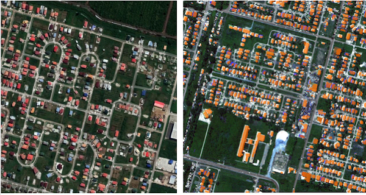
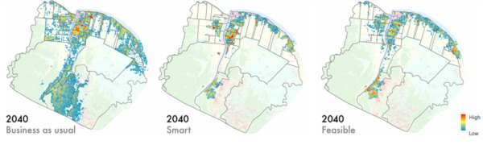
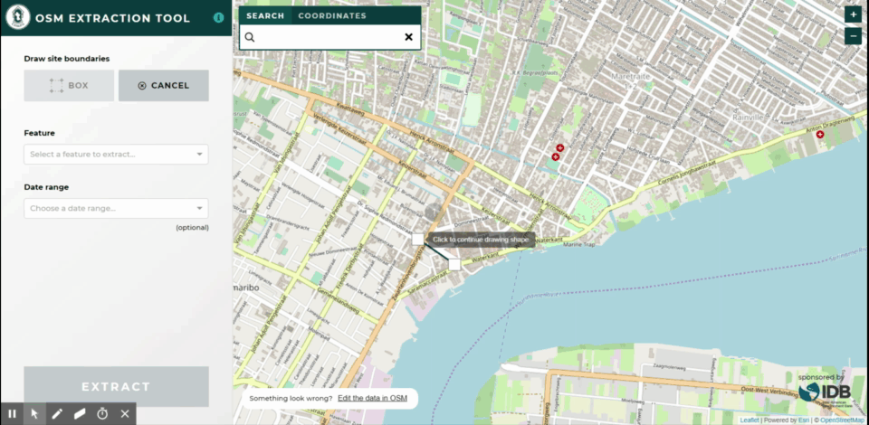
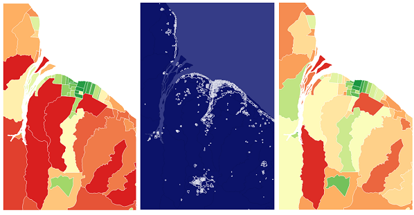
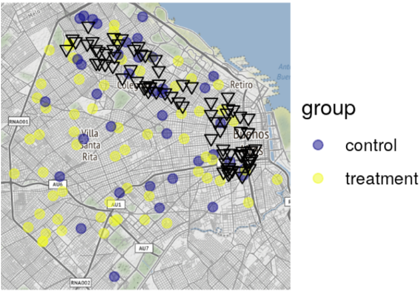
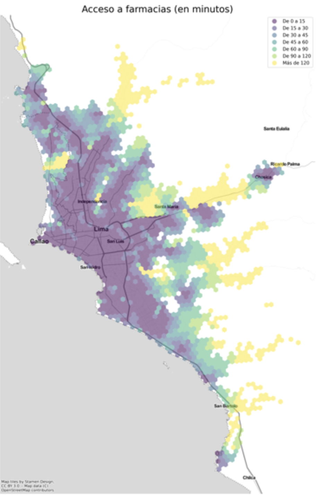

This article was originally posted on November 26, 2019 to the Inter-American Development Bank blog _Abierto al Publico_. It has since been [archived](https://web.archive.org/web/20260118085458/https://blogs.iadb.org/conocimiento-abierto/en/open-urban-planning-toolbox/#building-detection-model) on that blog and posted here. A version of the toolbox remains active and can be explored [here](https://www.iadb.org/en/who-we-are/topics/urban-development-and-housing/digital-applications-urban-planning). 

## These open-source tools leverage machine learning and crowdsourced data for urban development in Latin America and the Caribbean

“We don’t have data on that.” We hear these words repeatedly while working on urban development projects with cities and countries in Latin America and the Caribbean. This is problematic when we consider the region’s population is already 80% urban. Considering the digital revolution, Latin American and Caribbean cities should be poised to generate, analyze, and disseminate urban data. Yet, all too often, our partners do not have the tools necessary for delivering urban services to informal areas, identifying and allocating lands best suited for development while protecting at-risk areas, and working with individual families to assess and improve housing conditions, among other tasks. Much of the existing technology available to support this work is either too expensive, difficult to use, or not designed for the specific conditions of cities in a developing country.

### Open-source tools for Urban Planning in Latin America and the Caribbean

To address these needs, the IDB’s Housing and Urban Development Division (HUD) has developed an **Open Urban Planning Toolbox**, a set of open-source tools to support each step of the urban development planning process, from early design through implementation and evaluation of projects.

The methods and functions of the tools are mixed; Some use techniques such as **machine learning** as well as **crowdsourced data**. Finally, considering the importance of “ground-truthing” or field verification of the data and the understanding of urban challenges at the neighborhood and home level, we have also adapted a digital system of data collection in the field to guarantee information faster and spatially accurate.

All tools included in the toolbox to date are listed below. When a new tool is added, the list will be updated here. The links take you to the sections that describe each tool in more detail:

1. [Building Detection Model](#1-identify-existing-structures-with-the-building-detection-model)
2. [Urban Growth Model](#2-project-growth-with-the-urban-growth-model)
3. [OSM Extraction Tool](#3-generate-neighborhood-level-maps-with-the-osm-extraction-tool)
4. [OpenMapKit](#4-empower-digital-field-data-collection-with-openMapKit)
5. [Housing Deficit Estimator](#5-housing-deficit-estimator)
6. [Georeferenced Program Evaluation (GPE)](#6-map-and-analyze-the-geographic-reach-of-programs-with-georeferenced-program-evaluation-gpe)
7. [UrbanPy](#7-urbanpy)

These tools were developed by leveraging academic and private sector expertise in the context of specific IDB-funded projects. These include projects in Guyana, with the Adequate Housing and Urban Accessibility Program (GY-L1031) and Sustainable Housing for the Hinterland (GY-L1028); and Buenos Aires, Argentina (RG-T3397) within the framework of the Cities Laboratory. Several of these projects have included training and testing sessions between public officials and beneficiary communities to strengthen the development and use of the tools. By sharing the tools through the IDB’s Code for Development initiative, we invite our fellow planners and technologists to use and improve on the Open Urban Planning Toolbox.

### 1. Identify existing structures with the Building Detection Model

City planners often lack updated digital maps of existing buildings and structures. The Building Detection Model can automatically generate a basic map of buildings from satellite images. It uses semantic segmentation, which is the process of assigning each pixel in an image into a category; in this case, the categories are ‘building’ or ‘not building’. This allows planners to create detailed digital files of hard-to-reach and remote areas, such as the Guyana hinterland, where our partners are currently planning for housing interventions.

***On the left,*** *a regular satellite image.* ***On the right,*** *the Building Detection Model colorizes the buildings it has identified.*

Beyond generating a map of existing structures, urban and housing agencies can use the model’s results to estimate population size, neighborhood density, access to resources, etc., and as a base across which to extrapolate household level information. In addition, these estimates can help with downstream tasks such as measuring and detecting unplanned/informal urban sprawl, informing planned interventions and the provision of urban ecosystem services to such areas.

The model, which uses machine learning techniques for the basic categorization, was trained on data from Paramaribo (Suriname), Georgetown (Guyana) and Belize City (Belize), all of which have similar climate/vegetation, styles of architecture and patterns of urban sprawl. For improved results, the model should be re-trained for a new city with different topography and sprawl patterns.

**Inputs:** Satellite images
**Method:** Semantic segmentation with Raster Vision
**Language:** Python
**Outputs:** Building footprints

[View the repository here.](https://github.com/COMUNITARIO/Building-Detection)

### 2. Project growth with the Urban Growth Model

While urban growth prediction models are not new, they have historically required significant resources in time, expertise, and calculations. This model automates that process, allowing urban planners to spatially extrapolate the growth of their city under different scenarios (e.g., future population size, different time horizons, sensitivity to restricted areas, degree of randomness, etc.), based on past growth and current land use.

As inputs, the model uses monochrome images with standardized size and boundaries prepared from satellite images of an urban area. These images can be physical maps, density maps, or maps denoting legislative or social boundaries, depending on the conditions of the urban area and the modeler’s discretion. Attraction features will include, for instance, proximity to transit stations, and will be assigned a positive weight; restrictor features will include conditions such as flood-risk or conservation lands and will be assigned a negative weight.

*The model allows for the visualization of different growth scenarios, depending on the calibrations and inputs.*

Using these inputs, a regularized spatial logistic regression model predicts future urban growth on a pixel-by-pixel level within the determined boundaries, and outputs a binary raster file showing growth.

**Inputs:** Processed single-feature images
**Method:** Lasso-regularized spatial logistic regression
**Language:** Python
**Outputs:** Binary prediction file

View the repository here.

### 3. Generate neighborhood-level maps with the OSM Extraction Tool

Even in relatively well-established urban areas, development can take place informally or without complete records. Luckily, OpenStreetMap (OSM) uses crowdsourcing to generate detailed data at the building level. It is not always easy to download this data, however. Previously, an API called Overpass has been used to pull this data, but it requires knowledge of its own specific query language, which can be a significant barrier to urban planners without training in programming.

*The tool allows analysts to pull data on specific attributes from a selected area.*

Our OSM Extraction Tool eliminates the need to write any code and offers a more user-friendly and intuitive interface to extract relevant shapefiles and fill data gaps. The tool allows users to select specific areas; download detailed maps of roads, buildings, and other features in those areas; and update or add information to existing GIS data. Files downloaded from the OSM Extraction Tool can be conflated (selectively merged) with existing records using JOSM (Java OpenStreetMap) editor.

**Inputs:** Existing GIS data (if none is available, this tool can still work with no base data)
**Language:** JavaScript
**Outputs:** Shapefiles (roads, buildings, waterways, etc.)

[View the repository here.](https://github.com/COMUNITARIO/idb-osm-extraction-tool)

### 4. Empower digital field data collection with OpenMapKit

Paper records are still quite common for field data collection in many housing agencies, where the infrastructure required to create, implement, manage and maintain survey data often includes paywalls or high levels of technical expertise. OpenMapKit (OMK) solves one of the most immediate needs for government agencies to collect and manage data from the field, incorporating automatic georeferencing into the collection process.

*Staff from Guyana’s Central Housing and Planning Authority train for field data collection with OMK.*

The kit consists of an Android mobile device and three software components: the OMK Server (which allows users to store and manage survey data), OMK Survey App (which allows users to create and edit digital surveys), and the OpenDataKit (ODK) Collection App (the main interface for users to collect survey data in the field).

Surveys are created in the office with a drag-and-drop interface (including instructions and skip logic) and downloaded onto the enumerator’s android device. Once in the field, the survey can then use all the sensors and functionality available on the phone: text, numbers, photographs, videos, annotations, signatures, etc.; for geospatial data, the software connects directly to the phone’s GPS or allows manual placement of points and polygons directly on a map.

**Inputs:** Android phone, Designed survey
**Language:** Java
**Outputs:**  Georeferenced survey results

[View the repository here.](https://github.com/COMUNITARIO/idb-omk-pilot)

### 5. Housing Deficit Estimator

At the national level, governments may lack recent detailed information on housing needs. Incomplete or out-of-date understanding might result in well-intentioned but wasteful policies that fail to address the most pressing problems. A classic example of this problem is ‘building housing in the desert’, wherein a government spends millions to build more houses far from jobs and services, when in fact residents’ problems would have been much better addressed – and at a much lower cost – had they received subsidies for home improvement in the relatively central locations where they already lived.

***Left:*** *Qualitative housing deficit in the surrounding areas of Georgetown, Guyana, 2012.* ***Center:*** *Nocturnal luminosity extracted from satellite imagery of the same geographic area.* ***Right:*** *Estimated qualitative housing deficit, 2019*

The Housing Deficit Estimator first uses a methodology based on a similar exercise by Colombia’s Department of Statistics (DANE) to numerically standardize the national quantitative and qualitative housing deficit by the smallest available administrative division.

In Guyana, as in many other countries in Latin America and the Caribbean, qualitative housing needs (low-durability materials, lack of access to services, etc) are much more pressing than quantitative needs (the availability of any kind of housing). An association analysis shows which contributors to qualitative deficit are commonly associated with one another.

Finally, using a methodology popularized by the World Bank, the Housing Deficit Estimator uses nocturnal luminosity (‘night lights’) as a proxy for urban built-up environment and infrastructure to estimate qualitative housing needs in years when census data is not available.

**Inputs:** Census data, nighttime satellite images
**Method:** Indexing, association analysis, simple regression
**Language:** R
**Outputs:** Granular estimates of qualitative housing need

[View the repository here.](https://github.com/COMUNITARIO/Housing_Deficit)

### 6. Map and analyze the geographic reach of programs with Georeferenced Program Evaluation (GPE)

Access to resources in cities can vary greatly from neighborhood to neighborhood, often along socioeconomic lines. A successful social program must address these disparities upfront, actively seeking to provide services in areas of the city where resources are typically scarce. This R package provides geographic analysis and visualization of services used within a city, allowing the user to verify if a given program reached neighborhoods where the need is greatest, study patterns of use around the city, and otherwise assess the program’s geographic impact.

*Georeferenced evaluation of the Culture Pass project in Buenos Aires.*

Developed to analyze the impact of Culture Pass, a program to [broaden youth access to the extensive cultural life in Buenos Aires](https://obs.agenda21culture.net/en/good-practices/buenos-aires-culture-pass), this R package includes functions that will allow the user to:

1. Georeference addresses
2. Obtain base maps of any city’s urban grid
3. Estimate a matrix of distances between origin and destination
4. Calculate metrics of frequency, distribution by group, and distance travelled by consumers/beneficiaries to points of sale/access
5. Create visualizations that explore the difference between frequency and type of consumption by consumer/beneficiary attribute

**Inputs:** tabular data with addresses, or “lon” and “lat” columns
**Language:** R
**Outputs:** georeferenced locations, program evaluation maps and other visualizations, estimates of distance and delay

[View the repository here.](https://github.com/EL-BID/GPE)

### 7. UrbanPy

An open-source tool that combines spatial analysis with demographic variables. Keep learning about the tool UrbanPy [here](https://github.com/EL-BID/urbanpy).

### What’s next for the Open Urban Planning Toolbox?

Data-driven urban planning also demands proper modelling and understanding of dynamic urban systems. Upcoming HUD projects will see tools for this kind of contextual analysis added to the Toolbox, including crowd-sourced mobility mapping using General Transit Feed Specification (GTFS), a format that enables open and collaborative use of urban transport data.

Open-source software is made stronger by the community that contributes to it. We welcome users to apply the tools in their own cities, share ideas for improvement, and help identify areas of need that could be addressed with new open-source tools.

As we continue to add to our Toolbox, we will always follow key values: a shared commitment to open data and open-source tech; improved access to cutting-edge techniques, such as artificial intelligence, through active collaboration with global partners; and a focus on the participatory and democratic use of digital technology.

We’d love to hear about successful applications of these tools in the comments below. Also, please feel free to reach out for new opportunities to collaborate at pzambrano@iadb.org.

#### Authors:

<html>
<head>
    <meta content="width=device-width, initial-scale=1.0">
    
</head>
<body>

    

        
        

            <h3 class="author-name">Patricio Zambrano Barragán</h3>
            
Patricio Zambrano-Barragán was a Housing and Urban Development Specialist at the Inter-American Development Bank. He currently led urban development projects throughout Latin America and the Caribbean, including housing policy and finance projects; resilient urban infrastructure; and geospatial and civic data analytics. Prior to joining the IDB, he led research on territorial management and climate-ready infrastructure at the Massachusetts Institute of Technology and the Natural Resources Defense Council (NRDC). Patricio has worked with the Office of the Deputy Mayor in Quito, Ecuador; with the New York City Department of Housing Preservation and Development (HPD) on distressed asset financing; and as a management consultant with New York-based Katzenbach Partners. Patricio is a doctoral candidate in City and Regional Planning at the University of Pennsylvania, and holds a Master's in City and Regional Planning from the Massachusetts Institute of Technology and a B.A. in Political Science from Yale University.

        

    

 

    

        
        

            <h3 class="author-name">Jordan Jasuta Fischer</h3>
            
Jordan Jasuta Fischer trabaja en inteligencia artificial y análisis cognitivo en la división de sector público de IBM. Previamente, se especializaba en proyectos de código abierto, tecnología cívica y análisis geoespacial en Latinoamérica con el BID. Su experiencia en soluciones tecnológicas, gerencia de datos, y análisis avanzado en el campo del desarrollo internacional ha cubierto temas tan diversos como la administración pública, la salud pública, y los derechos humanos. Jordan tiene una maestría en Análisis de Negocios de la Universidad de George Washington y un bachillerato en Economía de la Universidad de Utah.

        

    

 

    

        
        

            <h3 class="author-name">Edgar Lemus</h3>
            
Edgar is a map-maker and civic technologist with a background in Environmental Science, Policy and Management. At the IDB, he explores strategies in public service innovation in Latin America and the Caribbean. Particularly, through the deployment of open software for geostatistical analysis to improve the technical capacities of local governments, bridge the geographic data gap in the region, and build climate change resiliency.

        

    

 

</body>
</html>

---
<!--
### Projects Overlay

To set what image links appear in the overlay menu edit `_data/projects.yaml`. Use the following format to set the URL, title, image and project status for as many links as you'd like. If you set `completed` to `false` like `completed: false`, it won't be clickable until you set it true like `completed: true`


- title: Moon Jekyll Theme
  url: http://taylantatli.me/Moon
  image: https://cloud.githubusercontent.com/assets/754514/14509720/61c61058-01d6-11e6-93ab-0918515ecd56.png
  completed: true

- title: Ramme Jekyll Theme
  url: http://taylantatli.me/Ramme
  image: https://raw.githubusercontent.com/TaylanTatli/Ramme/master/assets/img/screenshot-post.png
  completed: true

- title: Daisy Pelican Theme
  url: http://taylantatli.me/Daisy-Pelican-Theme/
  image: https://raw.githubusercontent.com/TaylanTatli/Daisy-Pelican-Theme/master/Preview-1.png
  completed: true

- title: Block Icon Theme
  url: https://github.com/TaylanTatli/Block-Icon-Theme
  image: https://raw.githubusercontent.com/TaylanTatli/Block-Icon-Theme/master/Preview.png
  completed: false

- title: Start Page
  url: http://taylantatli.me/StartPage/
  image: https://raw.githubusercontent.com/TaylanTatli/StartPage/master/preview.png
  completed: false


---
 -->
