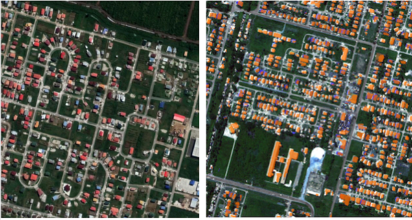
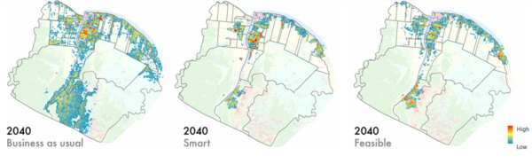
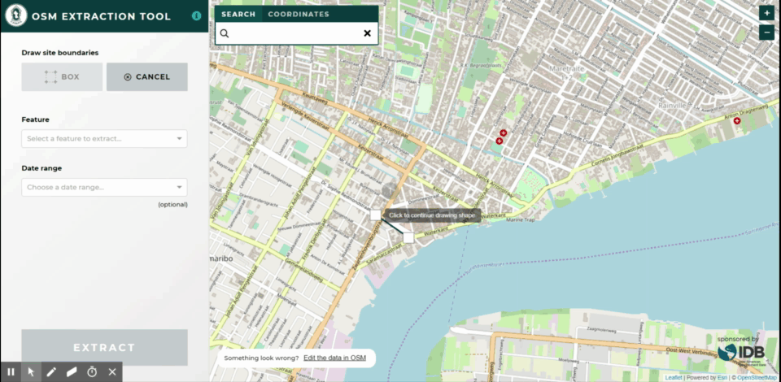
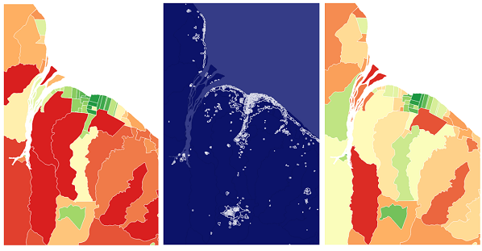
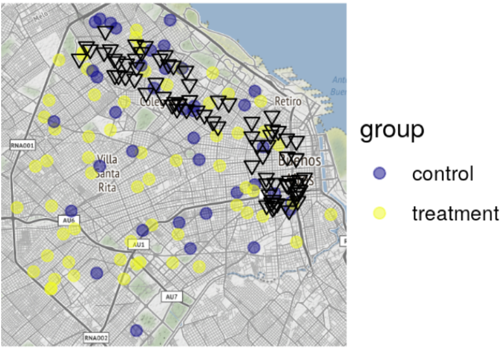
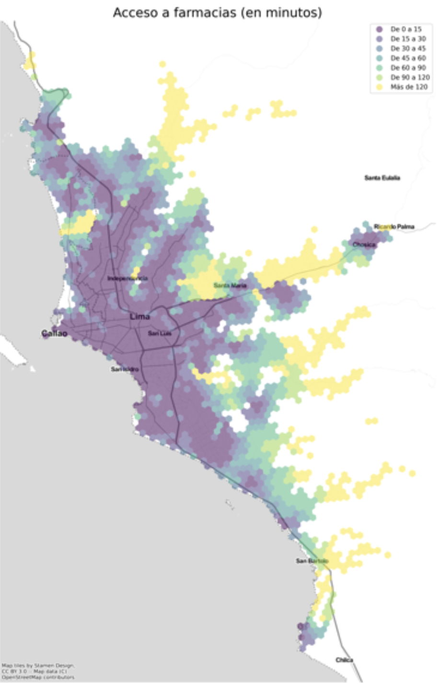

Este artículo fue originalmente publicado el 28 de julio del 2020 al blog _Abierto al Publico_ del Banco Interamericano de Desarrollo. Desde entonces ha sido [archivado](https://web.archive.org/web/20250117215723/https://blogs.iadb.org/conocimiento-abierto/es/open-urban-planning-toolbox-planificacion-urbana/) en ese blog y publicado aquí. Una versión del Toolbox sigue activa y se le puede explorar [aquí](https://www.iadb.org/en/who-we-are/topics/urban-development-and-housing/digital-applications-urban-planning).

## Estas herramientas de código abierto utilizan el aprendizaje automático y los datos de colaboración masiva para avanzar el desarrollo urbano en América Latina y el Caribe.

This post is also available in / Este artículo está también disponible en: [English](./2019-11-26-presenting-oupt-eng.md)

“No tenemos datos sobre eso.” Solemos escuchar esta frase en los proyectos de desarrollo urbano que trabajamos con ciudades y países de América Latina y el Caribe. La falta de datos presenta un reto cuando consideramos que la población de la región ya es 80% urbana. Teniendo en cuenta la revolución digital, las ciudades de América Latina y el Caribe deberían estar preparadas para generar, analizar y difundir datos urbanos. Sin embargo, muchas veces nuestros socios no tienen las herramientas necesarias para hacer su trabajo diario más eficiente. Tareas como prestar servicios urbanos a áreas informales, identificar y asignar las tierras más adecuadas para el desarrollo al tiempo que protegen las áreas en riesgo, y trabajar con familias individuales para evaluar y mejorar las condiciones de vivienda, entre otras pueden resultar onerosas en tiempo y recursos. Gran parte de la tecnología existente para apoyar este trabajo es demasiado costosa, difícil de utilizar o no está diseñada para las condiciones específicas del contexto local.

### Herramientas de código abierto para la planificación urbana en América Latina y el Caribe

Para atender esta realidad, la División de Vivienda y Desarrollo Urbano del BID ha desarrollado el **Open Urban Planning Toolbox**, una caja de herramientas que ofrece un conjunto de implementaciones de código abierto para respaldar cada paso del proceso de la planificación urbana, desde el diseño temprano hasta la ejecución y evaluación de proyectos. Los métodos y las funciones de las herramientas son mixtos; algunas utilizan técnicas como el **aprendizaje automático** y los datos generados por **crowdsourcing**. Finalmente, considerando la importancia de la “verificación en campo” (ground-truthing) de los datos y la comprensión de los desafíos urbanos a nivel de vecindario y hogar, también hemos adaptado un sistema digital de **recolección de datos en el terreno** para garantizar información más rápida y espacialmente precisa.

Todas las herramientas incluidas en la caja hasta la fecha se enlistan a continuación. Cuando una nueva herramienta se agregue, la lista se actualizará aquí. Los enlaces te llevan a las secciones que describen cada herramienta en más detalle:

1. [Detector de inmuebles](#1-identificar-estructuras-existentes-con-el-modelo-detector-de-inmuebles)
2. [Predicción de crecimiento urbano](#2-proyectar-crecimiento-con-el-modelo-de-prediccion-de-crecimiento-urbano)
3. [Extracción de datos OSM](#3-generar-mapas-a-nivel-del-barrio-con-la-herramienta-de-extraccion-de-datos-osm)
4. [OpenMapKit](#4-potenciar-la-recoleccion-de-datos-en-campo-con-openmapkit)
5. [Estimación del déficit de vivienda](#5-estimacion-del-deficit-de-vivienda)
6. [Evaluación Georreferenciada de Programas (EGP)](#6-mapear-y-analizar-el-alcance-geografico-de-los-proyectos-con-la-evaluacion-georreferenciada-de-programas-egp)
7. [UrbanPy](#7-urbanpy)

Estas herramientas se desarrollaron aprovechando la experiencia académica y del sector privado en el contexto de proyectos específicos financiados por el BID. Estos incluyen proyectos en Guyana con el programa de Vivienda adecuada y accesibilidad urbana (GY-L1031) y Vivienda sostenible para el territorio interior (GY-L1028); y en Buenos Aires, Argentina (RG-T3397) en el marco del Laboratorio de Ciudades. Varios de estos proyectos han incluído sesiones de capacitación y pruebas entre los funcionarios públicos y las comunidades beneficiarias para fortalecer el desarrollo y el uso de las herramientas. Al compartir las herramientas a través de la iniciativa de Código para el Desarrollo del BID, invitamos a nuestros colegas planificadores y tecnólogos a utilizarlas y mejorarlas.

### 1. Identificar estructuras existentes con el modelo Detector de Inmuebles

Los planificadores urbanos muchas veces carecen de mapas digitales actualizados de inmuebles y estructuras urbanas existentes. El Detector de Inmuebles genera un mapa básico de edificios de manera automática usando imágenes satelitales. Usa segmentación semántica, que es el proceso de asignar cada píxel de una imagen a una categoría: en este caso, las categorías son ‘edificación’ o ‘no edificación’. Esto permite que los planificadores generen archivos digitales detallados de áreas remotas o difíciles de acceder, como el interior de Guyana, donde nuestros socios están actualmente planeando intervenciones de vivienda.

***A la izquierda,*** *una imagen de satélite normal.* ***A la derecha,*** *el Detector de Inmuebles colorea los edificios identificados.*

Más allá de generar un mapa de las estructuras existentes, las agencias de vivienda y planeación urbana pueden usar los resultados del modelo para estimar la población, densidad de barrios, acceso a recursos, etc., y como datos base para extrapolar estadísticos a nivel de hogar. Además, estas estimaciones pueden ser útiles para tareas de planificación urbana como la identificación y planeación de zonas informales/no planificadas, la información de intervenciones planeadas y el diseño y desarrollo de servicios urbanos.

El modelo, que usa técnicas de aprendizaje automático para la categorización básica, fue entrenado con imágenes de Paramaribo (Surinam), Georgetown (Guyana), y la Ciudad de Belice (Belice), de los cuales todos tienen clima/vegetación, estilos de arquitectura, y patrones de crecimiento urbano parecidos. Para resultados óptimos, el modelo debe ser entrenado para una ciudad nueva con nueva topografía y patrones de dispersión urbana.  

**Insumos**: imágenes satelitales
**Metodología**: segmentación semántica con Raster Vision
**Lenguaje**: python
**Productos**: perímetros de edificios digitalizados

[Ver el repositorio aquí.](https://github.com/COMUNITARIO/Building-Detection)

### 2. Proyectar crecimiento con el modelo de Prediccion de Crecimiento Urbano

Mientras los modelos que predicen el crecimiento urbano no son nuevos, históricamente han requerido significativos recursos en términos de tiempo, conocimiento, y poder de computo. Este modelo automatiza ese proceso, permitiendo que los planificadores urbanos extrapolen de manera espacial el crecimiento de su ciudad bajo diferentes escenarios (ej., población futura, diferentes rangos de tiempo, sensibilidad a áreas restringidas, nivel de aleatoriedad, etc.), con base en el crecimiento del pasado y el uso de suelo actual.  

Como insumos, el modelo usa imágenes monocromáticas de un tamaño y límite estandarizado preparadas a partir de imágenes satelitales de un área urbana. Estas imágenes pueden ser también representaciones en formato raster de mapas físicos, mapas de densidad, o mapas que denotan límites administrativos o sociales, dependiendo de las condiciones del área urbana y la discreción del modelador. Rasgos de atracción incluirán, por ejemplo, proximidad a las estaciones de tránsito, y se les asignará un peso positivo; rasgos restrictores incluirán condiciones como riesgo de inundación o tierras de conservación, y se les asignará un peso negativo.

##### *El modelo permite la visualización de escenarios de crecimiento distintos, dependiendo de las calibraciones e insumos.*

Usando estos insumos, un modelo regularizado de regresión logística espacial  predice el crecimiento urbano a nivel de píxel dentro de los límites determinados, y produce un archivo binario raster que muestra el crecimiento proyectado.  

**Insumos**: imágenes procesadas de rasgo único
**Metodología**: regresión logística espacial regularizada con lasso
**Lenguaje**: python
**Productos**: archivo binario de predicciones

Ver el repositorio aquí.  

### 3. Generar mapas a nivel del barrio con la herramienta de Extraccion de Datos OSM

Incluso en áreas urbanas relativamente bien establecidas, el desarrollo puede realizarse de manera informal o sin registros completos. Por suerte, la plataforma OpenStreetMap (OSM) emplea el crowd-sourcing (la generación de datos por colaboración masiva) para generar datos detallados a nivel de edificaciones. Sin embargo, no es siempre fácil bajar estos datos. Previamente, un API llamado Overpass ha proveído acceso a estos datos, pero su uso requiere conocimiento de su propio lenguaje de consultas, lo cual puede ser un obstáculo considerable para planificadores urbanos que no tienen entrenamiento en programación.  

*La herramienta permite que los analistas bajen datos sobre atributos específicos de un área seleccionada.*

Nuestra herramienta de Extracción de Datos OSM elimina la necesidad de escribir código y ofrece una interfaz más intuitiva y amigable al usuario para extraer los archivos de forma relevantes y así llenar vacíos de información. Con esta herramienta, un usuario puede seleccionar un área específica; bajar mapas detallados de calles, edificios, y otros atributos en esa área; y actualizar o agregar información a los datos internos en sus SIGs (Sistemas de Información Geográfica). Los archivos obtenidos a través de la Extracción de Datos OSM pueden ser integrados (selectivamente fusionados) con registros existentes usando el editor JOSM (Java OpenStreetMap).  

**Insumos**: datos de GIS disponibles (si no hay, aún funciona sin datos de base)
**Lenguaje**: JavaScript
**Productos**: shapefiles o datos de forma (carreteras, edificios, vías navegables, etc.)

[Ver el repositorio aquí.](https://github.com/COMUNITARIO/idb-osm-extraction-tool)

### 4. Potenciar la recoleccion de datos en campo con OpenMapKit

Los registros en papel son aún bastante comunes en la recolección de datos en campo para muchas agencias de vivienda, donde la infraestructura requerida para crear, implementar, y mantener datos de encuestas puede representar barreras de pago o requerir alto conocimiento técnico. OpenMapKit (OMK) soluciona una de las necesidades más inmediatas para estas agencias – recolectar y gestionar datos desde el campo, incorporando georreferenciación automática en el proceso de recolección.

*Personal de la Autoridad Central de Vivienda y Planeación de Guyana se entrena en recolección de datos en campo con OMK.*

El kit consiste en un aparato móvil Android y tres componentes de software: el Servidor OMK (donde los datos de encuesta se alojan y se gestionan), la Aplicación OMK Survey (que permite la creación y edición de encuestas digitales) y la aplicación OpenDataKit (ODK) Collection (la interfaz a través de la cual los usuarios recolectan datos de encuestas en campo).  

Las encuestas se crean en la oficina con una simple interfaz de “arrastrar y soltar” (incluyendo instrucciones de llenado y lógica para brincar preguntas dependiendo de las respuestas), y se bajan al aparato Android del enumerador. Una vez en campo, la encuesta puede aprovechar de todas las funcionalidades y sensores del aparato para capturar información en: texto, números, fotografías, vídeos, anotaciones, firmas, etc.; para los datos geoespaciales, el software se conecta directamente al GPS del celular o permite la colocación manual de puntos y polígonos en un mapa.  

**Insumos**: dispositivo Android, encuesta diseñada
**Lenguaje**: Java
**Productos**: conjunto de respuestas georreferenciadas de la encuesta

[Ver el repositorio aquí.](https://github.com/COMUNITARIO/idb-omk-pilot)

### 5. Estimacion del deficit de vivienda

A nivel nacional, los gobiernos pueden carecer de información detallada y reciente sobre las necesidades de vivienda. La comprensión incompleta o desactualizada puede dar lugar a políticas bien intencionadas pero derrochadoras que no abordan los problemas más apremiantes. Un ejemplo clásico de este problema es ‘construir viviendas en el desierto’, en el que un gobierno gasta millones para construir más casas lejos de los empleos y servicios, cuando de hecho los problemas de los residentes se habrían abordado mejor, y a un costo menor de si hubieran recibido subsidios para hacer mejoras en los hogares más centrales donde ya están viviendo.

***Izquierda:*** *Déficit de vivienda cualitativo en los alrededores de Georgetown, Guyana, 2012.* ***Centro:*** *Luminosidad nocturna extraída de imágenes satelitales de la misma área geográfica.* ***Derecha:*** *Déficit de vivienda cualitativo (estimado), 2019*

El **Estimador del déficit de vivienda** utiliza primero una metodología basada en un ejercicio parecido realizado por el Departamento Administrativo Nacional de Estadística de Colombia (DANE) para estandarizar numéricamente el déficit de vivienda cuantitativo y cualitativo nacional por la división administrativa más pequeña disponible.

En Guyana, como en muchos otros países de América Latina y el Caribe, las necesidades de vivienda cualitativas (materiales de baja durabilidad, falta de acceso a servicios, etc.) son mucho más apremiantes que las necesidades cuantitativas (la disponibilidad de cualquier tipo de vivienda). Un análisis de asociación muestra qué contribuyentes al déficit cualitativo se asocian comúnmente entre sí.

Finalmente, utilizando una metodología popularizada por el Banco Mundial, el Estimador del Déficit de vivienda utiliza la luminosidad nocturna (“las luces de noche”) como un proxy de la infraestructura urbana para estimar las necesidades de vivienda cualitativas en años en que no hay datos censales disponibles.

**Insumos**: datos del censo, imágenes satelitales nocturnas
**Método**: indexación, análisis de asociación, regresión simple
**Lenguaje**: R
**Productos**: estimaciones granulares de la necesidad de vivienda cualitativa

[Ver el repositorio aquí.](https://github.com/COMUNITARIO/Housing_Deficit)

### 6. Mapear y analizar el alcance geografico de los proyectos con la Evaluacion Georreferenciada de Programas (EGP)

El acceso a los recursos en las ciudades puede variar mucho de barrio a barrio, según el nivel socioeconómico de su población. Un programa social exitoso debe abordar esas asimetrías de frente, activamente buscando proveer servicios en áreas de la ciudad que típicamente carecen de recursos. Este paquete R provee análisis y visualización geográficos de los servicios accedidos dentro de una ciudad, así permitiendo la verificación de si un programa llegó a los barrios de más necesidad, el estudio de patrones de uso a lo largo de la ciudad, u otra evaluación del impacto geográfico del programa.

*Evaluación georreferenciada del proyecto Pase Cultural en Buenos Aires.*

Desarrollado para analizar el impacto de Pase Cultural, un programa para ampliar el acceso a la extensa vida cultural en Buenos Aires a los jóvenes, este paquete instalable de R contiene funciones que permitan:

1. Georreferenciar direcciones postales
2. Obtener mapas base con la grilla urbana de cualquier ciudad
3. Estimar una matriz de distancias entre origen y destino
4. Realizar métricas de frecuencia, distribución por grupos y distancia recorrida para transacciones/accesos entre beneficiarios/consumidores y puntos de oferta
5. Crear visualizaciones que permitan explorar la diferencia entre frecuencia y tipo de consumo por atributos de los beneficiarios

**Insumos**: datos tabulares con direcciones o columnas “lon” y “lat”
**Lenguaje**: R
**Productos**: ubicaciones georreferenciadas, mapas y otras visualizaciones para la evaluación de programas, estimaciones de distancia y tiempo de viaje

[Ver el repositorio aquí.](https://github.com/EL-BID/GPE)

### 7. UrbanPy

Una herramienta de código abierto para combinar el análisis espacial con variables demográficas. Sigue conociendo la herramienta UrbanPy [aquí](https://github.com/EL-BID/urbanpy).

### ¿Qué sigue para el Open Urban Planning Toolbox?

La planificación urbana basada en datos también exige un modelado y comprensión adecuada de los sistemas urbanos dinámicos. Próximos proyectos de desarrollo urbano en el BID incorporarán al Toolbox herramientas para soportar este tipo de análisis contextual, como el mapeo colaborativo de movilidad para generar archivos en la Especificación General de Transmisión de datos de Tránsito (GTFS), un formato que permite el uso abierto y colaborativo de datos del transporte urbano.

El software de código abierto es fortalecido por la comunidad que contribuye a él. Invitamos a los usuarios a aplicar las herramientas en sus propias ciudades, compartir ideas para mejorar y ayudar a identificar áreas de necesidad que podrían abordarse con nuevas herramientas de código abierto.

A medida que continuamos agregando a nuestra caja de herramientas, siempre seguiremos los valores clave de: un compromiso compartido con los datos abiertos y la tecnología de código abierto; acceso mejorado a técnicas de vanguardia, como la inteligencia artificial, a través de la colaboración activa con socios globales; y un enfoque en el uso participativo y democrático de la tecnología digital.

Nos encantaría conocer las aplicaciones exitosas a través de los comentarios abajo. O también, les invitamos a explorar nuevas oportunidades de colaboración escribiendo a pzambrano@iadb.org.

***Nota: Este artículo ha sido actualizado para reflejar la incorporación de nuevas herramientas a la caja. La versión original se publicó el 15 de mayo del 2019.***

#### Authors:

<html>
<head>
    <meta content="width=device-width, initial-scale=1.0">
    
</head>
<body>

    

        
        

            <h3 class="author-name">Patricio Zambrano Barragán</h3>
            
Patricio Zambrano-Barragán was a Housing and Urban Development Specialist at the Inter-American Development Bank. He currently led urban development projects throughout Latin America and the Caribbean, including housing policy and finance projects; resilient urban infrastructure; and geospatial and civic data analytics. Prior to joining the IDB, he led research on territorial management and climate-ready infrastructure at the Massachusetts Institute of Technology and the Natural Resources Defense Council (NRDC). Patricio has worked with the Office of the Deputy Mayor in Quito, Ecuador; with the New York City Department of Housing Preservation and Development (HPD) on distressed asset financing; and as a management consultant with New York-based Katzenbach Partners. Patricio is a doctoral candidate in City and Regional Planning at the University of Pennsylvania, and holds a Master's in City and Regional Planning from the Massachusetts Institute of Technology and a B.A. in Political Science from Yale University.

        

    

 

    

        
        

            <h3 class="author-name">Jordan Jasuta Fischer</h3>
            
Jordan Jasuta Fischer trabaja en inteligencia artificial y análisis cognitivo en la división de sector público de IBM. Previamente, se especializaba en proyectos de código abierto, tecnología cívica y análisis geoespacial en Latinoamérica con el BID. Su experiencia en soluciones tecnológicas, gerencia de datos, y análisis avanzado en el campo del desarrollo internacional ha cubierto temas tan diversos como la administración pública, la salud pública, y los derechos humanos. Jordan tiene una maestría en Análisis de Negocios de la Universidad de George Washington y un bachillerato en Economía de la Universidad de Utah.

        

    

 

    

        
        

            <h3 class="author-name">Edgar Lemus</h3>
            
Edgar is a map-maker and civic technologist with a background in Environmental Science, Policy and Management. At the IDB, he explores strategies in public service innovation in Latin America and the Caribbean. Particularly, through the deployment of open software for geostatistical analysis to improve the technical capacities of local governments, bridge the geographic data gap in the region, and build climate change resiliency.

        

    

 

</body>
</html>

---
<!--
### Projects Overlay

To set what image links appear in the overlay menu edit `_data/projects.yaml`. Use the following format to set the URL, title, image and project status for as many links as you'd like. If you set `completed` to `false` like `completed: false`, it won't be clickable until you set it true like `completed: true`


- title: Moon Jekyll Theme
  url: http://taylantatli.me/Moon
  image: https://cloud.githubusercontent.com/assets/754514/14509720/61c61058-01d6-11e6-93ab-0918515ecd56.png
  completed: true

- title: Ramme Jekyll Theme
  url: http://taylantatli.me/Ramme
  image: https://raw.githubusercontent.com/TaylanTatli/Ramme/master/assets/img/screenshot-post.png
  completed: true

- title: Daisy Pelican Theme
  url: http://taylantatli.me/Daisy-Pelican-Theme/
  image: https://raw.githubusercontent.com/TaylanTatli/Daisy-Pelican-Theme/master/Preview-1.png
  completed: true

- title: Block Icon Theme
  url: https://github.com/TaylanTatli/Block-Icon-Theme
  image: https://raw.githubusercontent.com/TaylanTatli/Block-Icon-Theme/master/Preview.png
  completed: false

- title: Start Page
  url: http://taylantatli.me/StartPage/
  image: https://raw.githubusercontent.com/TaylanTatli/StartPage/master/preview.png
  completed: false


---
 -->
